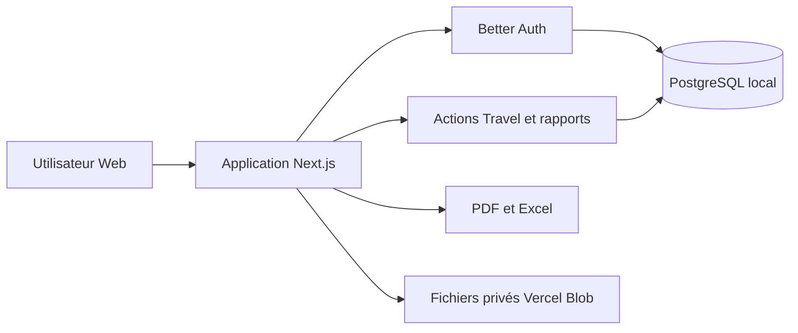
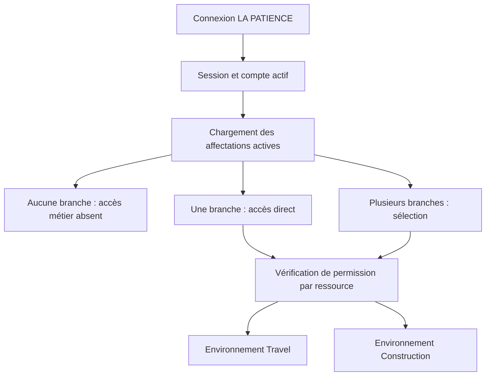
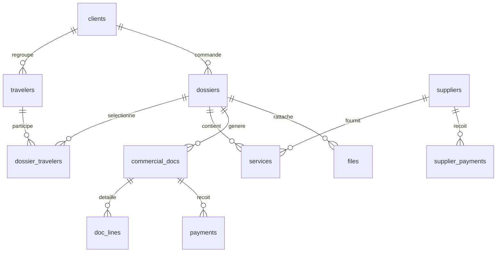

# LA PATIENCE — Cahier des charges détaillé
## Portail commun, Travel, Construction, données, architecture et Desktop hors ligne

Version : 1.0 — 12 novembre 2026  
Projet analysé : C:/Users/HP/Documents/patience-saas  
Statut : cadrage à valider, fondé sur le code existant.  
Destinataires : direction, responsables métiers, développeurs, exploitation et recette.

## Sommaire

1. Périmètre et méthode
2. Base de données : explication et situation réelle
3. Services et microservices : explication et choix d’architecture
4. État de l’existant
5. Objectifs et limites
6. Organisation, branches, comptes et permissions
7. Portail et authentification
8. Règles générales des interfaces
9. Clients et voyageurs
10. Dossiers Travel
11. Prestations Travel
12. Devis, factures, paiements et devises
13. Fournisseurs, dépenses et caisse
14. Documents, PDF et Excel
15. Indicateurs et tableaux de bord
16. Construction : périmètre proposé
17. Architecture applicative
18. Modèle de données actuel et cible
19. Transactions, concurrence et idempotence
20. API et contrats
21. Desktop, PWA et hors ligne
22. Sécurité et données personnelles
23. Installation et exploitation
24. Sauvegarde, reprise et déploiement
25. Performance, accessibilité et qualité
26. Tests et recette détaillée
27. Migration et plan de réalisation
28. Livrables, décisions et risques
29. Glossaire et sources
30. Annexe : dictionnaire exhaustif des tables et colonnes
31. Annexe : points d’entrée techniques existants
32. Annexes exploitation, schemas et tracabilite

## 1. Périmètre et méthode

### 1.1 Objet du document

Définir une application interne commune à LA PATIENCE, donnant accès aux activités Travel et Construction selon les droits de chaque utilisateur. Décrire précisément ce qui existe, ce qui doit être fiabilisé et ce qui constitue une extension. Fournir une base de décision, de développement et de recette.

Les objectifs ne sont pas seulement esthétiques : préserver la cohérence des montants, empêcher les accès non autorisés, permettre une installation reproductible et définir les limites réelles d’un fonctionnement local ou hors ligne.

### 1.2 Statuts de lecture

| Statut | Sens |
|---|---|
| Observé dans le code | Présent dans les sources ; ne prouve pas une recette complète |
| Vérifié localement | Contrôle réellement exécuté, avec une portée explicitée |
| Exigence cible | Comportement attendu, pas nécessairement développé |
| Proposition à valider | Choix soumis à une décision métier ou technique |
| Hors périmètre initial | Travail qui ne doit pas être promis implicitement |

P0 : préalable à la sécurité ou à l’intégrité de données réelles. P1 : nécessaire à la première version opérationnelle. P2 : amélioration ou extension. Les priorités ne sont pas des durées.

### 1.3 Sources de l’analyse et limites

Analyse du manifeste, du schéma Drizzle, de la connexion, des actions serveur, des routes, des rapports, des écrans et de la navigation. Les annexes sont extraites des sources. Les propositions Construction, permissions par branche et hors ligne ne doivent pas être prises pour des fonctionnalités déjà disponibles.

Vérifications réalisées durant la session : connexion PostgreSQL réussie ; 22 tables créées ; HTTP 200 sur la connexion ; redirection de la racine vers la connexion sans session ; TypeScript sans erreur ; build réussi avant le dernier ajustement des espacements, puis TypeScript et HTTP revérifiés après celui-ci. Aucun parcours métier authentifié complet n’est déclaré validé. Le navigateur automatisé était indisponible pour la vérification visuelle.

Ce cahier n’est ni une certification de sécurité, ni une validation fiscale, ni une promesse de performance déjà mesurée.

## 2. La base de données : explication et situation réelle

### 2.1 À quoi sert une BD ?

La base de données conserve les informations structurées : clients, personnes qui voyagent, dossiers, montants, factures, utilisateurs et droits. Le navigateur présente un formulaire ; le serveur vérifie la demande ; la base enregistre ; la page affiche le résultat confirmé.

Une table est un registre ; une ligne représente un objet ; une colonne est un attribut. Dans clients, chaque ligne représente un client. Sa clé primaire est son identifiant technique. Sa référence commerciale est un autre champ, lisible par l’équipe.

Une clé étrangère contraint une relation : par exemple, empêcher un dossier de désigner un client inexistant. Un index accélère certaines recherches ; il ne remplace pas une règle de sécurité. Une transaction regroupe des écritures liées pour qu’elles réussissent ou échouent ensemble.

### 2.2 Quelle base est utilisée ici ?

| Élément | Situation locale |
|---|---|
| Moteur | PostgreSQL 17, installé via paquet Windows 17.11-5 |
| Service Windows | postgresql-x64-17, observé en fonctionnement |
| Base applicative | patience_local |
| Adresse | 127.0.0.1 |
| Port | 5432 |
| Compte applicatif | patience_app |
| Pilote Node.js | pg |
| Outil d’accès typé | Drizzle ORM |
| Schéma | lib/db/schema.ts |
| Nombre de tables | 22 |
| Configuration | .env.local, ignoré par Git |
| Base locale du navigateur | Aucune implémentation observée |

Les secrets ne figurent pas dans ce document. Un compte SQL applicatif dédié a été créé. Le contrôle du mot de passe d’administration PostgreSQL et de ses privilèges reste une étape de durcissement avant exploitation.

L’initialisation a créé les tables, un paramètre d’agence générique et la devise USD. Elle n’a pas ajouté de clients, dossiers ou paiements fictifs. Les coordonnées et référentiels définitifs doivent être renseignés par l’entreprise.

### 2.3 Drizzle n’est pas une autre base

Drizzle décrit et interroge PostgreSQL depuis TypeScript. Le fichier du schéma ne suffit pas à créer les tables sur une nouvelle machine. Il faut des migrations ou une procédure d’initialisation versionnée. La création locale réalisée pendant cette session doit être rendue reproductible dans le dépôt.

### 2.4 Où sont les fichiers ?

La table files contient les métadonnées : nom, taille, catégorie, chemin, auteur et rattachement. Le code envoie le contenu à Vercel Blob en accès privé. Une base PostgreSQL locale ne rend donc pas les passeports et pièces disponibles hors Internet.

Il faut choisir : configurer Blob, développer un stockage local sécurisé ou organiser un modèle hybride. Les sauvegardes doivent couvrir à la fois SQL et les fichiers. Une sauvegarde SQL seule ne restitue pas les pièces.

### 2.5 Pourquoi les pages ne répondaient pas ?

Sans DATABASE_URL, le pilote essayait une connexion locale par défaut. Aucun PostgreSQL n’écoutait sur 5432 ; le serveur renvoyait ECONNREFUSED et les pages dépendantes de la base échouaient avec HTTP 500. L’absence de BETTER_AUTH_URL provoquait aussi un avertissement de connexion.

Le moteur installé, le schéma créé et la configuration locale ont rétabli la page initiale. Cette résolution ne constitue pas une validation de tous les modules.

## 3. Services et microservices : explication et choix d’architecture

### 3.1 Trois sens différents du mot service

1. Une prestation métier : visa, billet, hôtel ou assurance. C’est le sens de la table services.
2. Un service logiciel interne : fonction ou module chargé de créer une facture ou calculer un solde.
3. Un service autonome : programme déployé séparément avec son contrat réseau et sa responsabilité.

Le fichier app/actions/billing.ts n’est pas un microservice : il est exécuté dans la même application Next.js que les autres modules.

### 3.2 Qu’est-ce qu’un microservice ?

Un microservice est une application autonome chargée d’une capacité métier, avec un déploiement indépendant, un contrat de communication et la responsabilité de ses données. Un système peut par exemple avoir un service commandes et un service facturation communiquant par API ou messages.

Cette séparation ajoute des problèmes à résoudre : identité entre services, latence, pannes réseau, cohérence entre bases, surveillance et reprise. Un dossier de code nommé services ne produit pas cette architecture.

Référence : [Microsoft — Microservices architecture style](https://learn.microsoft.com/en-us/azure/architecture/guide/architecture-styles/microservices).

### 3.3 Architecture actuelle

Une application Next.js unique ; des pages serveur et composants clients ; des Server Actions ; des routes HTTP pour fichiers/PDF/exports/authentification ; une base PostgreSQL ; un stockage de fichiers externe. Aucun ensemble de microservices métier autonomes n’a été observé.

### 3.4 Recommandation propre à ce projet

Conserver initialement une application unique organisée en modules : identité, organisation, Travel, Construction, commercial, trésorerie, documents et reporting. Cette recommandation découle du dépôt actuel et des transactions fortement liées.

| Option | Intérêt | Coût/risque | Décision proposée |
|---|---|---|---|
| Application sans frontières | Mise en route simple | Règles dupliquées, couplage | À améliorer |
| Monolithe modulaire | Peu de composants à exploiter, transactions simples | Discipline d’architecture | Cible initiale |
| Microservices | Autonomie de déploiement et de charge | Exploitation et cohérence distribuées | Seulement sur besoin démontré |

Deux branches ne nécessitent pas deux serveurs. Une extraction future peut concerner les documents lourds ou notifications si volume, disponibilité et équipe responsable le justifient.

## 4. État de l’existant

### 4.1 Technologies déclarées

| Couche | Technologies |
|---|---|
| Application | Next.js 16.4.3, React 19, App Router |
| Langage | TypeScript 5.7.3 |
| Interface | Tailwind CSS 4, composants shadcn/Base UI, Lucide |
| Connexion | Better Auth 1.7.15, email et mot de passe |
| Données | PostgreSQL, pg, Drizzle ORM |
| Documents | React PDF, ExcelJS |
| Fichiers | Vercel Blob |
| Graphiques | Recharts |
| Paquets | pnpm déclaré ; lockfiles pnpm et npm présents |
| Scripts disponibles | dev, build, start |

Versions relevées au moment de l’analyse ; ne pas les considérer comme une garantie de compatibilité ou de sécurité future.

### 4.2 Fonctions observées

Clients et voyageurs ; dossiers ; prestations Travel ; devis et factures ; encaissements ; fournisseurs ; paiements fournisseurs ; dépenses et mouvements de caisse ; documents ; PDF ; Excel ; tableaux de bord ; comptes et paramètres ; devises ; journal.

### 4.3 Manques structurants

| Sujet | Constat | Exigence |
|---|---|---|
| Construction | Identité au portail, pas de modèle BTP | Cadrage et développement séparés |
| Branches | Rôle global, pas d’affectations | Modèle utilisateur–branche–permission |
| SaaS externe | Pas d’isolation multi-entreprise | Décider du besoin avant réalisation |
| Hors ligne | Pas de PWA/synchronisation observée | Architecture dédiée |
| Relations SQL | Peu de FK métier explicites | Contraintes après contrôle de données |
| Facturation | Écritures successives | Transactions, concurrence, idempotence |
| Taux inconnu | getRate renvoie 1 si absent | Refus explicite |
| Statuts | annule et annulee selon objets | Référentiel commun aux rapports |
| Listes | Limites fixes 200/300 | Pagination réelle |
| Installation | Pas de migrations versionnées observées | Installation reproductible |
| Qualité | Pas de scripts lint/tests ; ignoreBuildErrors activé | Pipeline bloquant |
| Stockage | Dépendance réseau pour les fichiers | Choix explicite du mode local/cloud |

Les requêtes de lib/reports.ts et certaines actions filtrent les prestations par statut différent de annule, alors que les constantes de billet/hôtel/assurance utilisent annulee. Des prestations annulées pourraient donc contribuer aux montants. À reproduire et corriger avec tests.

## 5. Objectifs et limites

### 5.1 Objectifs

Un portail unique ; des droits adaptés ; un Travel fiable ; des documents traçables ; une base sauvegardée ; un futur Construction correctement modélisé ; un mode hors ligne limité mais honnête ; une évolution possible vers plusieurs entreprises si le besoin commercial existe.

### 5.2 Périmètre initial proposé

P0/P1 : installation, migrations, transactions, droits par branche, Travel, fichiers, sauvegarde/restauration, tests. Extension : Construction après ateliers. Extension ultérieure : PWA lecture et brouillons. SaaS commercial externe : décision distincte, avec quotas, abonnements et exploitation.

Deux activités de LA PATIENCE ne sont pas deux tenants. Le nom patience-saas ne prouve pas que la plateforme possède déjà une isolation multi-entreprise.

### 5.3 Exclusions sans spécification complémentaire

GDS et émission automatique de billets ; décision consulaire ; souscription automatique d’assurance ; débit de cartes ; comptabilité générale réglementaire ; paie ; calcul structurel BTP ; signature électronique qualifiée.

Un champ « numéro de billet » ne réalise pas une émission chez une compagnie. Le mode de règlement « carte » n’effectue pas un paiement bancaire.

## 6. Organisation, branches, comptes et permissions

### 6.1 Modèle cible

Organisation : propriétaire des données. Branche : Travel ou Construction. Affectation : lien utilisateur–branche avec rôle, statut et validité. Permission : action autorisée. Périmètre : objets accessibles.

Une personne peut avoir plusieurs affectations et des rôles différents. Ne pas laisser deux sources contradictoires entre rôle global et rôles de branche.

### 6.2 Rôles

Actuels : admin, responsable et agent. Cibles proposées : administrateur d’organisation, responsable de branche, agent Travel, chef de projet, agent de chantier, gestionnaire financier et lecteur. Tous les nouveaux profils demandent validation et implémentation.

### 6.3 Matrice cible à valider

| Action | Administrateur | Responsable branche | Agent affecté | Finance affectée | Lecteur |
|---|---|---|---|---|---|
| Gérer comptes et affectations | Oui | Non | Non | Non | Non |
| Consulter métier | Permission explicite | Sa branche | Son périmètre | Son périmètre | Son périmètre |
| Créer client/dossier | Permission métier | Oui | Oui | Selon délégation | Non |
| Modifier dossier | Permission métier | Sa branche | Selon affectation | Non par défaut | Non |
| Émettre facture | Permission métier | Oui | À valider | Oui | Non |
| Encaisser | Permission métier | Oui | À valider | Oui | Non |
| Annuler/contrepasser | Permission dédiée | Selon délégation | Non | Selon délégation | Non |
| Voir coûts et marges | Permission dédiée | Oui | Non par défaut | Oui | Non par défaut |
| Exporter | Permission dédiée | Selon rapport | Selon rapport | Selon rapport | Non par défaut |
| Voir passeport | Finalité et permission | Selon dossier | Selon dossier | Non par défaut | Non par défaut |

L’administration technique ne donne pas automatiquement un accès universel aux pièces personnelles.

### 6.4 Exigences

**IAM-01 / P0** : vérifier identité, compte actif, affectation, permission et rattachement sur chaque requête sensible.

**IAM-02 / P0** : interdire les objets d’une autre branche même si l’identifiant est deviné dans une URL ou envoyé directement.

**IAM-03 / P1** : une branche autorisée implique redirection directe ; plusieurs impliquent sélecteur ; aucune implique état explicite sans accès métier.

**IAM-04 / P0** : révocation prise en compte au prochain accès serveur. Définir une expiration hors ligne, car un poste déconnecté ne peut recevoir une révocation centrale instantanément.

Recette : agent Travel refusé sur Construction, export interbranche refusé, permission retirée bloquant aussi téléchargement et mutation directe.

## 7. Portail et authentification

### 7.1 Présentation

Zone institutionnelle bleue à environ 45 % sur ordinateur ; formulaire blanc sur le reste. Logos officiels sans redessin. Construction et Travel présentés sans boutons de connexion indépendants. Phrase : « Un espace. Plusieurs métiers. »

À 1366×768 et 1440×900, formulaire normal entièrement visible à zoom 100 %, sans scroll inutile. Tester aussi configuration initiale et erreurs. À 320×568 et sur mobile, défilement autorisé pour préserver les contrôles. À zoom 200 %, la lisibilité et l’accès priment sur l’absence de scroll. Ne pas cacher un débordement avec un overflow global.

### 7.2 Exigences

**AUTH-01 / P1** : email et mot de passe obligatoires ; labels persistants ; autocomplétion et clavier adaptés. Identifiant non email seulement après ajout d’une correspondance unique.

**AUTH-02 / P1** : afficher/masquer le mot de passe avec libellé accessible et conservation de la valeur.

**AUTH-03 / P0** : pendant envoi, progression et bouton désactivé ; après erreur réseau, déblocage et reprise ; pas de double soumission.

**AUTH-04 / P0** : erreur d’identifiants neutre ; panne de service distincte ; pas de détails SQL ou de secrets.

**AUTH-05 / P0** : pas d’inscription publique après initialisation. Bootstrap administrateur limité, atomique et désactivé après provisionnement. Le comptage des comptes seul ne protège pas deux inscriptions simultanées.

**AUTH-06 / P1** : pas de faux lien de récupération. Sans service, contact administrateur. Future récupération : jeton limité, unique, réponse neutre, politique de sessions et fournisseur d’envoi configuré.

### 7.3 États

Initial, chargement, identifiants rejetés, service indisponible, session expirée, compte désactivé, branche absente et choix de branche. Une future connectivité distingue réseau détecté, API joignable et synchronisation terminée.

## 8. Règles générales des interfaces

### 8.1 Listes

Recherche et filtres serveur ; tri stable ; pagination avec total. Proposition : 25 lignes et options 25/50/100. Les limites actuelles de 200 ou 300 ne constituent pas une pagination. Conserver filtres dans l’URL sans données sensibles inutiles.

Différencier absence de données, filtre sans résultat et indisponibilité de source. Aucun tableau de démonstration ne doit masquer une panne.

### 8.2 Formulaires

Validation serveur indépendante du HTML ; valeurs préservées après rejet ; erreurs rattachées aux champs ; focus accessible ; Annuler non soumettant ; avertissement si fermeture avec changements. Suppression décrivant objet et dépendances.

Dates civiles stockées comme date ; horodatages cibles en UTC avec affichage selon fuseau validé. Ne pas confondre heure de vol, date de naissance et date de création. Ce dépôt a ses propres règles de dates : ne pas importer implicitement les règles d’un autre projet.

### 8.3 Confirmation et attente

Succès seulement après confirmation durable. Une requête expirée peut avoir été enregistrée : proposer de retrouver le résultat plutôt que ressaisir aveuglément. Les erreurs importantes persistent dans la page, même si une notification disparaît.

## 9. Clients et voyageurs

### 9.1 Distinction

Le client commande ou paie. Le voyageur voyage. Un client peut avoir plusieurs voyageurs et plusieurs dossiers. Le code crée un voyageur titulaire lors de la création client ; sa synchronisation ultérieure avec l’identité du client doit être clarifiée pour éviter deux versions contradictoires.

### 9.2 Fiche client

Référence serveur ; type particulier/entreprise ; prénom, nom et société ; téléphone, email et adresse ; ville/pays/nationalité ; naissance ; passeport et expiration ; notes ; auteur et dates techniques.

**CLI-01 / P1** : champs obligatoires selon type ; décider du représentant pour une société car prénom/nom sont actuellement non nuls.

**CLI-02 / P1** : normaliser téléphone/email. Clarifier le refus actuel de doublon par téléphone : une famille peut partager un numéro.

**CLI-03 / P0** : dates civiles réelles ; naissance non future ; pas d’hypothèse universelle de validité du passeport à six mois.

**CLI-04 / P1** : historique dossiers/documents/voyageurs/solde selon droits ; passeport partiellement masqué.

**CLI-05 / P0** : client facturé non supprimable physiquement par opération ordinaire ; archivage et politique de données personnelles.

### 9.3 Voyageurs

Identité, relation, naissance, genre si justifié, nationalité, passeport et expiration. Contrôler l’appartenance au client du dossier. Une exception doit être autorisée explicitement. Retirer un lien dossier–voyageur ne supprime pas la personne ni les documents historiques.

Recette : société avec trois voyageurs ; mineur sans email ; homonymes ; téléphone familial ; passeport expiré ; client facturé supprimé ; modification de l’identité titulaire.

## 10. Dossiers Travel

### 10.1 Données

Référence, client, agent, titre, destination, statut, priorité, départ, retour, échéance, notes, voyageurs, prestations et historique. États actuels : en_attente, en_cours, termine, annule. Priorités : normale, urgente.

### 10.2 Transitions cibles à valider

| Transition | Conditions | Effet |
|---|---|---|
| En attente → En cours | Client valide, objet et responsable | Étape opérationnelle |
| En cours → Terminé | Contrôle des prestations ; politique de solde | Clôture datée |
| En attente/En cours → Annulé | Autorisation, motif, engagements examinés | Traitement explicite des suites |
| Terminé/Annulé → En cours | Réouverture autorisée et motivée | Trace et nouvelles échéances |

**DOS-01 / P0** : retour avant départ refusé ; références client/agent contrôlées.

**DOS-02 / P1** : chronologie append-only avec auteur/date serveur ; notes distinctes des événements techniques.

**DOS-03 / P0** : annuler ne supprime pas paiements et engagements ; parcours explicite de remboursement/correction.

**DOS-04 / P1** : protéger un dossier terminé ; réouverture explicite. Définir clôture opérationnelle et financière si elles diffèrent.

### 10.3 Interface

En-tête contexte ; vue générale ; voyageurs ; prestations ; facturation ; documents ; chronologie. Montants et coûts masqués si nécessaire. Échéances et pièces manquantes reposent sur des données structurées plutôt que sur un texte arbitraire.

## 11. Prestations Travel

### 11.1 Socle

Type, description, état, fournisseur, coût, vente, devise, taux historique et détails. Taux positif connu. Avertissement ou validation des marges négatives à décider. Modifier une prestation facturée ne doit pas réécrire une facture émise.

### 11.2 Visa

Champs observés : pays, type de visa, rendez-vous, dépôt, décision, documents requis/manquants et résultat. Types : tourisme, affaires, études, travail, transit, famille. États : à préparer, rendez-vous pris, déposé, en traitement, accordé, refusé.

**VIS-01** : décision non antérieure au dépôt ; rendez-vous avec fuseau connu.
**VIS-02** : checklist structurée si suivi fiable des pièces attendu.
**VIS-03** : décision externe enregistrée avec source ; aucun statut ne garantit une décision consulaire.
**VIS-04** : refus ne signifie pas automatiquement remboursement intégral.

### 11.3 Billetterie

Compagnie, itinéraire, type de trajet, départ/retour, PNR et numéros. États : réservé, émis, modifié, annulé.

**BIL-01** : numéro et date d’émission requis à l’état émis en cible.
**BIL-02** : plusieurs segments/voyageurs nécessitent un modèle structuré si contrôle individuel.
**BIL-03** : modification conserve versions, frais et références ; annulation fournisseur distincte de l’annulation interne.
**BIL-04** : émission externe hors périmètre tant qu’aucune intégration validée.

### 11.4 Hôtel

Établissement, ville, arrivée, départ, chambres et confirmation. États : demandé, confirmé, modifié, annulé. Départ après arrivée pour nuitées ; référence ou justificatif requis à confirmation. Nombre de chambres, occupants et pension à préciser selon besoins.

### 11.5 Assurance

Assureur, formule, garanties, dates et police. États : proposition, souscrit, annulé. Dates ordonnées ; police et justificatif à souscription. L’enregistrement n’effectue pas de souscription automatique.

### 11.6 Règles communes

**PRE-01 / P0** : transitions centralisées par type, exclusion cohérente des annulations.
**PRE-02 / P0** : correction financière historisée après facturation.
**PRE-03 / P1** : fournisseur historique conservé ; pas de règlement lié à un service d’un autre fournisseur.
**PRE-04 / P1** : schéma de validation de details par type ; ne pas accepter n’importe quelle clé JSON.

## 12. Devis, factures, paiements et devises

### 12.1 Objets distincts

Devis : proposition. Facture : somme due. Reçu : preuve d’encaissement. Avoir : correction commerciale. Remboursement : sortie d’argent. Les deux derniers ne sont pas des objets dédiés dans le schéma actuel et demandent développement.

### 12.2 Numérotation

Compteurs actuels par type/année sauf client ; préfixes configurables. Cible : allocation atomique, unicité SQL, non-modifiabilité, non-réutilisation. Le commentaire « gap-free » du code ne garantit pas une continuité réglementaire : une allocation suivie d’un échec peut créer un trou. Définir politique par entité et branche.

### 12.3 Devis

États : brouillon, envoyé, accepté, refusé. Lignes, quantités, prix, remise, échéance et notes. Conversion avec lien au devis.

**FAC-01 / P0** : conversion atomique et idempotente ; double clic ou concurrence ne créent pas deux factures. Contrainte d’unicité compatible avec annulation/réémission à définir.
**FAC-02 / P1** : conserver version envoyée/acceptée ; lignes comme instantané, pas recalcul depuis une prestation future.
**FAC-03 / P1** : transitions contrôlées, refus ou réouverture motivés.

### 12.4 Factures

États : émise, partielle, payée, annulée. Cible : immutabilité à émission, correction explicite par avoir/version selon règle validée. Les mentions et taxes sont à valider pour la juridiction et le statut de l’entreprise. Aucune certification fiscale dans ce document.

Total ligne = quantité × prix, arrondi défini. Sous-total = somme des lignes. Remise valide. Taxes seulement si modélisées. Total calculé serveur. Rejeter ou traiter explicitement une remise supérieure au sous-total ; ne pas masquer le problème avec un total ramené silencieusement à zéro.

### 12.5 Encaissement

Montant, devise reçue, taux figé, montant imputé, mode, référence, date, notes et auteur. Modes : espèces, virement, Mobile Money, carte, chèque. Une référence externe doit être requise selon le mode validé.

**PAY-01 / P0** : montant > 0, facture autorisée existante/non annulée, devise connue active, taux > 0 ; montant imputé déterminé au serveur.
**PAY-02 / P0** : contrôle du solde et insertion sous verrou transactionnel.
**PAY-03 / P0** : clé d’idempotence ; même demande répétée = même résultat ; même clé et autre charge = conflit.
**PAY-04 / P1** : contrepassation motivée au lieu d’effacement silencieux ; lien vers original et validation.
**PAY-05 / P1** : reçu retrouvable même si la réponse navigateur a été perdue.

Deux encaissements de 80 sur un solde de 100 ne doivent pas être tous deux acceptés. Le contrôle avant insertion, sans verrou, n’est pas suffisant.

### 12.6 Devises et calcul décimal

Convention proposée : taux = valeur d’une unité dans la devise de base. Base = montant × taux. Imputation facture = reçu × taux reçu / taux facture. Exemple purement pédagogique : taux A=2, taux B=4, réception 50 B → 100 A ; aucun taux réel ni donnée à charger.

Figer les taux historiques ; changement du référentiel sans réécriture du passé ; rejeter devise inconnue. Définir précision par devise, source des taux et arrondi. Les numeric SQL ne suffisent pas si le code calcule avec des nombres flottants sans politique contrôlée.

## 13. Fournisseurs, dépenses et caisse

### 13.1 Fournisseurs

Nom, catégorie, contact, coordonnées, notes, actif. Catégories Travel existantes : compagnie, consolidateur/GDS, hôtel, assurance, consulat, autre. Désactivation conserve l’historique.

Le solde actuel compare coûts de prestations et règlements. Ce n’est pas une comptabilité fournisseurs complète : factures d’achat, échéances et rapprochement nécessitent des objets supplémentaires.

### 13.2 Dépenses

Catégorie, libellé, montant/devise/taux, mode, date, notes et justificatif cible. Définir si engagement, approbation et paiement sont séparés. Les catégories et permissions sont validées par finance. Dépense rejetée et sortie de fonds confirmée ne doivent pas être confondues.

### 13.3 Caisse et comptes financiers

Caisse espèces ≠ banque ≠ Mobile Money. Les virements n’augmentent pas les espèces physiques. Cible : comptes par branche, type et devise ; solde initial ; comptage ; clôture ; écart expliqué.

**FIN-01 / P0** : transfert entre comptes = deux écritures liées atomiques, pas revenu et dépense doublés.
**FIN-02 / P1** : journée clôturée protégée ; correction ou réouverture autorisée.
**FIN-03 / P1** : seuils d’approbation et politique de caisse négative documentés.
**FIN-04 / P0** : rattachement fournisseur/prestation contrôlé lors d’un paiement.

## 14. Documents, PDF et Excel

### 14.1 Fichiers

Limite actuelle : 10 Mo ; PDF, certaines images, Word/Excel selon type déclaré. Cible : taille serveur, signature du contenu, extension cohérente, nom sécurisé et analyse adaptée. Le MIME fourni par le navigateur ne prouve pas la nature réelle.

**DOC-01 / P0** : accès via route authentifiée, contrôle branche/objet/confidentialité.
**DOC-02 / P0** : protéger aussi noms, catégories, listes et recherches, pas seulement le binaire.
**DOC-03 / P1** : échec Blob puis SQL géré par compensation/état temporaire ; suppression partielle suivie.
**DOC-04 / P1** : version, empreinte, auteur, date ; fichier important non écrasé silencieusement.
**DOC-05 / P0** : aucun lien public permanent pour un passeport.

### 14.2 PDF

Logo de l’émetteur/branche ; coordonnées ; numéro et dates ; destinataire ; lignes ; devise ; remises/taxes validées ; totaux et conditions. Tester accents, longs noms, plusieurs pages, répétition d’en-têtes, absence de coupures des totaux. Une facture historique conserve ses mentions d’époque.

### 14.3 Excel

Rapports en liste blanche, droits par branche/rapport, période valide, colonnes typées, montants numériques, devise visible, date d’extraction et filtre rappelés. Neutraliser les textes interprétables comme formules. Export sensible tracé. Gros exports asynchrones avec lien temporaire autorisé si nécessaire.

### 14.4 Option de stockage local

Adaptateur serveur sur dossier hors accès web public, contrôle des chemins, ACL Windows, sauvegardes et journal. Ne pas exposer directement un dossier Windows au navigateur. Cache poste seulement pour documents explicitement autorisés, avec quota et effacement.

## 15. Indicateurs et tableaux de bord

| Indicateur | Définition cible | Date |
|---|---|---|
| Facturé | Factures valides moins corrections retenues | Émission |
| Encaissé | Paiements confirmés moins remboursements | Encaissement |
| Reste à recevoir | Total moins imputations nettes | Situation à date |
| Vente prestations | Vente des prestations éligibles | Reconnaissance à choisir |
| Coût prestations | Coût du même périmètre | Même convention |
| Marge brute | Vente moins coût | Périmètre cohérent |
| Flux net | Encaissements moins règlements et dépenses | Mouvements |
| Caisse | Ouverture + entrées espèces − sorties espèces | Caisse et date |

Le net actuel est un flux simplifié, pas un bénéfice net comptable. Facturé et encaissé ne s’additionnent pas comme deux revenus. Les rapports actuels supposent une base USD à plusieurs endroits : changer defaultCurrency ne garantit pas leur conversion correcte.

**REP-01 / P0** : branche, période, devise et méthode des taux visibles.
**REP-02 / P0** : totaux identiques écran/export pour le même périmètre.
**REP-03 / P1** : cartes reliées à leurs lignes autorisées ; zéro distinct d’une source indisponible.
**REP-04 / P1** : dates réelles, début ≤ fin, période maximale d’export validée.
**REP-05 / P1** : alertes d’échéances, pièces et impayés fondées sur règles explicites.

## 16. Construction : périmètre proposé, non développé

### 16.1 Atelier préalable

Confirmer gros œuvre, second œuvre, rénovation, conception, sous-traitance, matériaux ; forfait/métré ; stocks ; engins ; présence ; achats ; situations et retenues. Aucun workflow BTP ne doit être considéré validé parce qu’il est proposé ici.

### 16.2 Projets et chantiers

Projet : référence, maître d’ouvrage/client, site, responsable, contrat, budget, dates et état. Décider si projet et chantier doivent être séparés, un projet pouvant porter plusieurs sites.

Lots/tâches : responsable, dépendances, unités, quantités, dates, jalons et avancement. Mesure de l’avancement avec méthode, auteur et preuve, pas seulement un pourcentage libre.

Journal : date, équipe, travaux, incidents, observations, photos, validation et rectification historisée.

### 16.3 Budget et devis

Bordereau : ouvrage, libellé, unité, quantité, prix unitaire, coût et marge. Référentiel d’unités validé ; unités incompatibles non additionnées. Budget initial distinct des révisions et avenants. Comparer prévu, engagé, réalisé et payé sans les confondre.

### 16.4 Achats et stock

Demande → approbation → commande → réception partielle/complète → facture d’achat → règlement. Liens conservés et quantités restantes calculées.

Stock : article, unité de base, dépôt, entrée, sortie, transfert et inventaire. Définir propriété des matériaux, coûts et retours. Deux sorties concurrentes ne doivent pas consommer une même quantité disponible.

### 16.5 Sous-traitance, engins, main-d’œuvre

Sous-traitant : contrat, lot, engagement, avancement validé, retenue si définie et paiement. Engin : affectation, disponibilité et coût si nécessaire. Présences/costs main-d’œuvre sans inclure implicitement la paie. Données personnelles minimisées.

### 16.6 Situations de travaux

Acompte, avancement cumulé, déduction des situations précédentes, avenants, retenues et facture finale selon contrat. Ne pas réutiliser directement une ligne Travel de quantité 1 pour un décompte au métré.

Critères : situation non doublonnée, cumul justifié, dépassement approuvé, historique des mesures et rapprochement paiements. Mentions et retenues à valider par responsables compétents.

### 16.7 Tables candidates

construction_projects, construction_sites si utile, work_packages, work_items, project_budget_versions, project_budget_lines, site_daily_logs, site_log_attachments, purchase_requests, purchase_orders, purchase_order_lines, goods_receipts, goods_receipt_lines, stock_locations, stock_items, stock_movements, subcontracts, work_measurements, progress_statements, progress_statement_lines.

Pour chaque objet : branche, identifiant, référence si nécessaire, état, auteur, dates, version, FK et archivage. Créer seulement les tables correspondant aux workflows validés. Le dictionnaire BTP final demande les ateliers.

## 17. Architecture applicative cible

### 17.1 Flux actuel

Navigateur → Next.js → Better Auth et actions métier → PostgreSQL. Next.js produit PDF/Excel et accède au stockage privé. Toute page serveur métier dépend de la disponibilité du serveur et de la base.

### 17.2 Responsabilités proposées

| Module | Possède | Ne doit pas faire |
|---|---|---|
| Identité | Comptes, sessions, activation | Calcul financier |
| Organisation | Branches, affectations, politiques | Logique visa |
| Travel | Dossiers et prestations | Stock BTP |
| Construction | Chantiers, mesures et achats | Décision consulaire |
| Commercial | Numéros, documents, corrections | Réécrire les prestations en silence |
| Trésorerie | Paiements, imputations et comptes | Doubler le facturé dans les revenus |
| Documents | Métadonnées, accès et stockage | URL publique sensible |
| Reporting | Projections et définitions | Corriger directement les sources |
| Audit | Preuves d’actions | Stocker des secrets |

### 17.3 Organisation de code proposée

Entrées Web dans app ; cas d’usage dans des modules métier ; validation au plus près des contrats ; accès SQL explicites ; adaptateurs stockage/envoi ; permissions partagées ; tests d’intégration. Éviter une requête SQL copiée dans trois écrans avec trois règles d’annulation différentes.

Les modules restent dans le même déploiement au départ. Un worker peut exécuter PDF lourds, exports ou notifications après un événement outbox. Sa présence doit être justifiée et supervisée.

### 17.4 Si extraction en microservices

Préconditions : besoin mesuré, équipe propriétaire, contrat stable, métriques, authentification machine, timeouts/retries, versionnement et tests de contrat. Le service possède ses données : un autre module ne modifie pas directement ses tables.

Avec deux bases, le rollback SQL local n’annule pas une opération distante. Prévoir événements, idempotence et compensations. Ne pas ajouter Kubernetes ou un bus complexe sans besoin d’exploitation validé.

## 18. Modèle de données actuel et cible

### 18.1 Répartition actuelle

| Famille | Tables | Nombre |
|---|---|---:|
| Authentification | user, session, account, verification | 4 |
| Paramètres | agency_settings, counters, currencies | 3 |
| Travel | clients, travelers, dossiers, dossier_travelers, dossier_steps, suppliers, services | 7 |
| Commercial | commercial_docs, doc_lines, payments | 3 |
| Sorties/caisse | supplier_payments, expenses, cash_movements | 3 |
| Fichiers/audit | files, audit_logs | 2 |
| Total | | 22 |

### 18.2 Relations métier

Client → voyageurs et dossiers. Dossier ↔ voyageurs par dossier_travelers. Dossier → prestations, étapes et documents commerciaux. Fournisseur → prestations et règlements. Document commercial → lignes et paiements. Client/dossier → fichiers. Utilisateur → sessions et comptes d’authentification.

Ces liens métier ne sont pas tous des FK effectives. Dans le schéma observé, les FK explicites portent surtout sur session.userId et account.userId. L’annexe précise ce qui est déclaré.

### 18.3 Tables transversales proposées

| Table | Champs principaux | Règle |
|---|---|---|
| organizations si besoin externe | id, code, nom, état, devise, fuseau | Code unique |
| branches | id, organisation, code, nom, état | Unicité organisation/code |
| branch_memberships | utilisateur, branche, rôle, état, validité | Affectation unique cohérente |
| permissions | code, description | Codes stables |
| role_permissions | rôle, permission | Clé composite |
| financial_accounts | branche, type, devise, nom, état | Compte identifié |
| exchange_rates | devise, base, taux, validité, source | Taux > 0 |
| idempotency_requests | scope, clé, empreinte, état, résultat | Unicité scope/clé |
| outbox_events | type, agrégat, charge, état, tentatives | Écriture transactionnelle |
| payment_reversals | paiement, montant, motif, validateur | Lien à l’original |
| document_versions | document, clé stockage, empreinte, version | Version unique |

Avoirs : modèle commercial étendu ou tables dédiées à décider, avec référence d’origine, lignes et motif. Ne pas créer une abstraction générique qui permette de relier une facture à un objet inexistant.

### 18.4 Contraintes et colonnes

branch_id obligatoire sur données de branche après migration. organization_id si multi-organisation confirmé, ou rattachement fiable avec isolation ; duplications cohérentes contrôlées. Version de concurrence sur objets modifiables. Archivage plutôt que suppression pour objets engagés.

FK sur clients, voyageurs, dossiers, fournisseurs, prestations et documents ; contraintes de statut ; taux positifs ; montants selon objet. Les règles de somme de paiements exigent une logique transactionnelle, pas un simple CHECK isolé.

### 18.5 Index à mesurer

Dossiers : branche/statut/date, branche/agent/échéance, client. Prestations : dossier, fournisseur, type/statut. Factures : branche/type/statut/date, client/échéance, devis source. Paiements : facture/date, compte/date, idempotence. Documents : client/catégorie, dossier/catégorie. Audit : branche/date, auteur/date, objet/date.

Vérifier les plans sur données représentatives. Ne pas multiplier les index sans coût mesuré.

### 18.6 Types

Montants actuels majoritairement numeric(14,2), taux numeric(18,6), quantités numeric(10,2). Précisions à valider selon devises et unités. Calcul décimal contrôlé ou unités entières adaptées ; tests d’arrondi.

Horodatages actuels souvent sans fuseau. Migration éventuelle vers timestamptz avec interprétation historique documentée, sans supposer le fuseau des anciennes valeurs.

## 19. Transactions, concurrence et idempotence

### 19.1 Opérations atomiques

Client + voyageur titulaire ; dossier + liens voyageurs ; facture + lignes + totaux ; conversion devis ; paiement + statut ; contrepassation ; transfert ; stock ; situation BTP.

Une transaction PostgreSQL valide ou annule les écritures regroupées. Référence : [PostgreSQL — Transactions](https://www.postgresql.org/docs/current/tutorial-transactions.html).

### 19.2 Encaissement cible pas à pas

1. Vérifier format, session et permission.
2. Déterminer le périmètre autorisé.
3. Ouvrir une transaction sur une même connexion.
4. Réserver/relire clé d’idempotence et empreinte.
5. Verrouiller la facture et relire état/solde.
6. Valider devise, taux, montant et conversion.
7. Allouer référence ; écrire paiement et imputation.
8. Recalculer statut ; écrire audit et événement éventuel.
9. Sauver résultat idempotent ; valider.
10. Répondre avec résultat durable et reçu retrouvable.

READ COMMITTED avec verrou peut suffire si toutes les écritures respectent le même invariant ; sinon étudier isolation plus forte et reprise des conflits. Le choix doit être démontré par des tests concurrents.

### 19.3 Effets externes

Email et Blob ne sont pas annulés par le rollback SQL. Outbox écrite avec la transaction puis traitement asynchrone idempotent, suivi des tentatives, délai, échecs et reprise. Afficher séparément « facture créée » et « email envoyé ».

## 20. API et contrats

### 20.1 Situation

Server Actions pour les mutations ; routes pour auth, fichiers, PDF et exports. Ce n’est pas une API publique stable par défaut.

### 20.2 Commandes cibles

requestId, branche demandée mais vérifiée, expectedVersion si modification, charge métier. Identité, rôle, auteur et dates techniques déterminés serveur. Résultat typé avec identifiant, référence, version, état et erreurs sans secrets.

Erreurs proposées : VALIDATION_ERROR, UNAUTHENTICATED, FORBIDDEN, NOT_FOUND, VERSION_CONFLICT, DUPLICATE_REQUEST, INVALID_TRANSITION, INSUFFICIENT_BALANCE, DEPENDENCY_UNAVAILABLE. Statuts HTTP cohérents pour les routes ; résultat typé adapté aux Server Actions.

### 20.3 Endpoints futurs proposés

| Contrat | Usage | Invariant |
|---|---|---|
| GET /api/v1/me/branches | Affectations | Session serveur |
| GET /api/v1/travel/dossiers | Liste | Pagination et périmètre |
| POST /api/v1/travel/dossiers | Création | Client autorisé |
| POST /api/v1/quotes/{id}/convert | Conversion | Unicité/transaction |
| POST /api/v1/invoices/{id}/payments | Paiement | Solde verrouillé |
| POST /api/v1/files/uploads | Dépôt | Contenu et rattachement |
| GET /api/v1/sync/changes | Changements | Curseur et périmètre |
| POST /api/v1/sync/commands | Brouillons | Idempotence/version/droits |

Ces routes sont des propositions non implémentées. Documenter schémas et compatibilité avant usage externe.

## 21. Desktop, PWA et hors ligne

### 21.1 Modes à distinguer

| Mode | Internet | Serveur | Disponibilité actuelle |
|---|---|---|---|
| Web distant | Nécessaire pour requêtes | Distant | Architecture possible |
| Réseau local | Pas pour SQL local ; externe pour Blob | Machine du bureau | À organiser |
| PWA réellement déconnectée | Non pour fonctions préparées | Non pour données locales | Non implémentée |

Installer la PWA ne rend pas les composants serveur disponibles hors réseau. Localhost désigne le poste de chaque utilisateur ; un autre poste ne rejoint pas le serveur du bureau par son propre localhost.

### 21.2 Architecture proposée

Service worker : shell et ressources publiques versionnées. IndexedDB : données autorisées, brouillons, commandes et états de synchronisation. Cache sensible séparé et contrôlé. SQLite n’est pas utilisé actuellement ; option possible pour un Desktop natif, à étudier.

### 21.3 Capacités initiales proposées

| Fonction | Hors ligne | Reconnexion |
|---|---|---|
| Ouvrir shell déjà installé | Oui | Mise à jour contrôlée |
| Lire dossiers préparés | Selon droit/politique | Reprise différentielle |
| Chercher toute la base | Non | Recherche serveur |
| Créer dossier | Brouillon | Validation/référence serveur |
| Note/rapport chantier | Oui | Conflits/doublons contrôlés |
| Modifier prestation | Brouillon | Contrôles complets |
| Facture définitive | Non au départ | Numérotation serveur |
| Paiement confirmé | Non au départ | Solde transactionnel |
| Droits, utilisateurs, taux | Non | Serveur obligatoire |
| Passeports en cache | Non par défaut | Autorisation explicite |
| Pièce jointe | File locale et quota | Upload confirmé |

### 21.4 Déverrouillage

Première authentification en ligne, poste autorisé volontairement, droits locaux limités dans le temps, verrouillage après inactivité. Aucun mot de passe serveur en clair.

Un PIN court seul n’est pas une protection suffisante pour une base de passeports. Étudier clés protégées par plateforme ou secret robuste, chiffrement disque, compte Windows, effacement et récupération. Des clés accessibles au même code Web ne suppriment pas le risque XSS ou de poste compromis.

À la synchronisation, revérifier les droits actuels, même si un déverrouillage local a réussi.

### 21.5 Synchronisation et conflits

Chaque commande porte UUID, type, objet, version de base, date locale indicative et clé d’idempotence. Le serveur attribue date fiable et référence officielle. Changements téléchargés par curseur, avec tombstones et purge des données dont les droits ont été retirés.

États : local, en attente, en cours, synchronisé, conflit, rejeté. Garder le brouillon avant confirmation. Tester fermeture/reprise, envoi répété et stockage plein.

Notes nouvelles peuvent s’ajouter ; champs modifiés concurremment demandent résolution. Pas de « dernier arrivé gagne » sur argent, droits ou engagements. Références provisoires clairement distinctes des numéros officiels.

### 21.6 Contraintes plateforme

HTTPS à prévoir pour l’usage hors localhost concerné ; évaluer un accès LAN HTTP avant de promettre l’installation et le service worker. Quotas, éviction, stockage persistant et mises à jour testés sur navigateurs cibles. Les tâches arrière-plan ne sont pas garanties identiquement partout.

Référence : [MDN — Offline and background operation](https://developer.mozilla.org/en-US/docs/Web/Progressive_web_apps/Guides/Offline_and_background_operation). La matrice ci-dessus est une proposition produit.

## 22. Sécurité et données personnelles

### 22.1 Exigences P0

Secrets côté serveur et non versionnés. Compte SQL limité et distinct de l’admin. Contrôler/changer mot de passe administrateur initial si nécessaire. Pas de 5432 exposé à Internet. Filtrage LAN explicite si réellement requis.

Cookies/origines adaptés à chaque environnement ; réévaluer SameSite=None et secure=true appliqués en développement pour le contexte v0. Limitation des tentatives, contrôle des sessions et mécanismes de Better Auth effectivement configurés.

Contrôle sur pages, mutations, exports, aperçus et binaires. Échappement des notes, pas de HTML arbitraire. Pas de mot de passe/cookie/jeton/URL secrète/passeport brut dans les journaux.

### 22.2 Données personnelles

Finalités, responsables, durées, accès, rectification, suppression et sauvegardes documentés. Confirmer pays, localisation d’hébergement et obligations avec les responsables compétents. Aucune conformité juridique automatiquement déduite de ce cahier.

Minimiser les copies de passeports et naissances, masquer selon usage, chiffrer sauvegardes/postes, limiter les exports et journaliser accès sensibles.

### 22.3 Audit cible

Auteur, action, objet, identifiant, branche, date serveur, résultat et requestId. Avant/après limité aux champs utiles, sans secrets. Accès restreint, conservation, protection contre modification métier. audit_logs ne constitue pas à lui seul un registre inviolable.

Référence de principes : [OWASP — Authorization Cheat Sheet](https://cheatsheetseries.owasp.org/cheatsheets/Authorization_Cheat_Sheet.html), notamment refus par défaut et vérification systématique.

## 23. Installation et exploitation

### 23.1 Configuration

| Variable | Usage | Protection |
|---|---|---|
| DATABASE_URL | Connexion SQL | Secret |
| BETTER_AUTH_URL | URL canonique | Valeur adaptée au point d’accès |
| BETTER_AUTH_SECRET | Session/authentification | Secret critique |
| BLOB_READ_WRITE_TOKEN | Fichiers si Blob retenu | Secret fournisseur |
| Variables Vercel/v0 | Hébergement/prévisualisation | Ne remplacent pas une configuration LAN |

Actuellement, URL locale canonique : http://localhost:3000. Pour plusieurs postes, prévoir adresse stable, nom réseau, certificats, cookies et origines. L’IP du PC peut changer.

### 23.2 Procédure reproductible cible

1. Installer versions validées depuis sources officielles.
2. Créer base et rôle SQL dédiés.
3. Installer dépendances depuis le lockfile officiel.
4. Créer environnement depuis exemple sans secrets.
5. Appliquer migrations versionnées et contrôler la version.
6. Initialiser uniquement référentiels approuvés.
7. Créer premier administrateur par bootstrap contrôlé.
8. Configurer branches, devise, coordonnées et rôles.
9. Configurer/tester stockage et PDF.
10. Exécuter recette minimum.
11. Sauvegarder et restaurer dans une base isolée.
12. Désigner responsable et documenter démarrage/arrêt.

Choisir npm ou pnpm ; ne pas entretenir deux installations divergentes. Ne pas stocker un second schéma SQL manuel sans garantie de synchronisation avec Drizzle.

### 23.3 Usage quotidien

PostgreSQL est un service ; l’application a aussi besoin d’un serveur. next dev est destiné au développement. Exploitation : build, démarrage de production supervisé, logs, redémarrage et contrôle de disponibilité.

Un PC en veille coupe le service aux autres postes. Une machine serveur doit avoir politique d’alimentation, disque, sauvegarde et responsabilité identifiées. Les fichiers Blob restent dépendants du réseau même si SQL est local.

## 24. Sauvegarde, reprise et déploiement

### 24.1 Environnements

Développement, recette et production séparés : bases, secrets, comptes et fichiers. Pas de documents personnels copiés en développement sans procédure de minimisation autorisée.

### 24.2 Objectifs proposés

Sauvegarde logique PostgreSQL quotidienne chiffrée, copie indépendante du PC, fichiers sauvegardés, rétention à valider et échecs surveillés. Pour activité financière soutenue, augmenter fréquence et étudier restauration à un instant donné.

RPO proposé pour pilote peu actif : 24 h, à réduire pour exploitation financière intensive. RTO proposé : 4 h si machine de remplacement et procédure existent. Ce sont des objectifs à approuver, pas des garanties acquises.

### 24.3 Restauration

Isoler incident ; conserver éléments ; sélectionner sauvegarde ; restaurer dans base distincte ; restaurer fichiers cohérents ; vérifier volumes/liens/soldes ; tester comptes et PDF ; validation métier ; bascule ; rapport de perte éventuelle. Ne jamais écraser la seule base pour tester une sauvegarde.

### 24.4 Supervision

Application, base, stockage, latence, requêtes lentes, tentatives de connexion, disque, sauvegardes, tâches et synchronisations. requestId commun ; secrets exclus. Mesurer succès réel d’une restauration, pas seulement succès du fichier de sauvegarde.

## 25. Performance, accessibilité et qualité

### 25.1 Cibles à confirmer

| Fonction | Cible proposée | Conditions |
|---|---|---|
| Connexion | p95 < 3 s | LAN, serveur prêt |
| Liste 25 lignes | p95 < 2 s | 10 000 dossiers de recette |
| Fiche dossier | p95 < 2 s | Binaires à la demande |
| PDF ≤ 20 pages | < 5 s | Machine de référence |
| Charge pilote | 10 utilisateurs simultanés | Profil documenté |
| Login visuel | Sans scroll inutile | 1366×768, zoom 100 % |

Ces performances ne sont pas encore démontrées. Toute mesure précise matériel, charge, réseau, données et état chaud/froid.

### 25.2 Accessibilité

Objectif WCAG 2.2 AA à vérifier : contraste, focus, clavier, labels, lecture d’erreurs, zoom, ordre et absence de sens uniquement coloré. Zones tactiles adaptées ; contrôles iconiques nommés ; pas de notification éphémère seule pour une erreur critique.

### 25.3 Qualité

Typecheck, lint, tests, build bloquant sur erreurs de types, migrations revues, dépendances contrôlées et aucun secret dans Git. Retirer ignoreBuildErrors après stabilisation des contrôles. Centraliser permissions/statuts/calculs. Tests ciblant les invariants, pas seulement le rendu d’un composant.

## 26. Tests et recette détaillée

### 26.1 Niveaux

Unitaires : dates, taux, montants, permissions et transitions. Intégration SQL : FK, transactions, concurrence, migrations. Navigateur : parcours et responsive. Sécurité : accès interbranche, identifiants devinés, comptes désactivés. Exploitation : redémarrage, sauvegarde/restauration. Hors ligne : coupure, conflit, quota et révocation.

Données synthétiques uniquement dans environnement de test identifié. Ne pas charger de faux clients en production pour faire fonctionner les écrans.

### 26.2 Matrice

| ID | Scénario | Attendu | Priorité |
|---|---|---|---|
| REC-01 | Absence DATABASE_URL | Diagnostic de configuration exploitable | P0 |
| REC-02 | PostgreSQL arrêté | Erreur de service et reprise | P0 |
| REC-03 | Connexion valide | Session puis branche correcte | P0 |
| REC-04 | Mauvais mot de passe | Réponse neutre | P0 |
| REC-05 | Réseau coupé pendant login | Bouton débloqué | P0 |
| REC-06 | Compte désactivé, ancienne session | Accès refusé | P0 |
| REC-07 | Deux bootstrap simultanés | Un seul admin initial | P0 |
| REC-08 | Une branche | Redirection directe | P1 |
| REC-09 | Deux branches | Sélecteur sans reconnexion | P1 |
| REC-10 | Objet autre branche par URL | Refus sans fuite | P0 |
| REC-11 | Création client | Référence unique, titulaire lié | P1 |
| REC-12 | Échec après client avant voyageur | Rollback | P0 |
| REC-13 | Date impossible/naissance future | Refus serveur | P0 |
| REC-14 | Voyageur d’un autre client | Refus sauf exception définie | P0 |
| REC-15 | Retour avant départ | Refus | P1 |
| REC-16 | Dossier terminé modifié | Protection/réouverture | P1 |
| REC-17 | Tous types de services annulés | Rapports cohérents | P0 |
| REC-18 | Devise inconnue | Refus, pas de taux 1 | P0 |
| REC-19 | Taux courant modifié | Historique inchangé | P0 |
| REC-20 | Double conversion devis | Une facture selon règle | P0 |
| REC-21 | Crash facture avant lignes | Aucun objet partiel | P0 |
| REC-22 | Remise excessive | Refus/règle approuvée | P0 |
| REC-23 | Paiement partiel puis solde | Statuts corrects | P0 |
| REC-24 | Paiements concurrents > solde | Aucun dépassement | P0 |
| REC-25 | Même clé répétée | Résultat unique | P0 |
| REC-26 | Même clé, autre montant | Conflit | P0 |
| REC-27 | Timeout après validation | Résultat existant retrouvé | P0 |
| REC-28 | Annulation paiement clôturé | Contrepassation tracée | P0 |
| REC-29 | Virement dans caisse espèces | Exclu | P0 |
| REC-30 | Mauvais fournisseur/prestation | Refus | P0 |
| REC-31 | Fichier > 10 Mo | Refus, pas d’orphelin | P1 |
| REC-32 | MIME falsifié | Contrôle contenu | P0 |
| REC-33 | Pièce confidentielle interdite | Liste et binaire protégés | P0 |
| REC-34 | Blob réussi, SQL échoué | Compensation suivie | P1 |
| REC-35 | PDF long/accents | Pagination lisible | P1 |
| REC-36 | Écran/Excel même périmètre | Totaux identiques | P0 |
| REC-37 | Plus de 300 dossiers | Pagination complète | P1 |
| REC-38 | Login 1366×768 | Contrôles accessibles | P1 |
| REC-39 | Mobile/zoom 200 % | Aucun contenu perdu | P1 |
| REC-40 | Clavier seul | Focus et ordre corrects | P1 |
| REC-41 | Restauration isolée | SQL/fichiers/soldes cohérents | P0 |
| REC-42 | PWA préparée sans réseau | Lecture autorisée/brouillons | P2 |
| REC-43 | Brouillon renvoyé deux fois | Un objet central | P2 |
| REC-44 | Modification sur deux postes | Conflit explicite | P2 |
| REC-45 | Droits retirés hors ligne | Refus synchro/politique locale | P2 |
| REC-46 | Sorties de stock concurrentes | Quantité cohérente | P1 BTP |
| REC-47 | Situation déjà facturée | Pas de double imputation | P1 BTP |
| REC-48 | Réception partielle achat | Reste à recevoir correct | P1 BTP |

### 26.3 Réception d’un lot

Exigences reliées aux tests ; P0 du lot résolus ; migrations testées ; documentation ; contrôle visuel ; appels directs non autorisés refusés ; limites écrites ; responsable métier validant.

Un build ne prouve pas les règles métier. HTTP 200 sur login ne prouve pas l’accès complet. Un test manuel heureux ne prouve pas la concurrence.

## 27. Migration et plan de réalisation

### 27.1 Migration

Inventaire réel ; sauvegarde ; détection orphelins/doublons/statuts/montants ; correction approuvée ; ajout compatible de colonnes ; reprise ; contraintes ; code compatible ; retrait des anciennes voies après contrôle.

Rattacher les données Travel existantes à Travel après vérification, jamais à Construction par simple effet de marque. Ne pas créer de faux objets pour satisfaire une contrainte. Conserver mapping et rapport de reprise.

### 27.2 Lots proposés

| Lot | Travail | Dépendances | Sortie |
|---|---|---|---|
| L0 | Décisions métier et périmètre | Aucune | Référentiel validé |
| L1 | Installation/migrations/stockage/sauvegarde | L0 | Installation neuve et restauration |
| L2 | Transactions/taux/statuts/concurrence | L1 | Recette financière P0 |
| L3 | Branches/permissions/navigation | L1 | Isolation démontrée |
| L4 | Travel complet | L2/L3 | Parcours validés |
| L5 | Rapports/pagination/performance | L4 | Totaux concordants |
| L6 | Ateliers et modèle Construction | L0/L3 | Règles BTP validées |
| L7 | Réalisation Construction | L2/L6 | Projet pilote complet |
| L8 | PWA lecture/brouillons | L3/L4 | Coupure et conflits maîtrisés |
| L9 | Éventuel SaaS externe | Décision commerciale | Isolation multi-organisation |

Pas d’estimation ferme sans volumétrie, règles BTP, intégrations et disponibilité des décideurs. Chiffrer chaque lot avec hypothèses et incertitudes.

### 27.3 Définition de terminé

Code, données, migrations, tests, documentation et exploitation alignés ; validation métier ; erreurs et reprise maîtrisées ; fonctions non réalisées non annoncées comme disponibles. Ce cahier n’autorise pas implicitement un commit ou un déploiement.

## 28. Livrables, décisions et risques

### 28.1 Livrables

Cahier validé ; maquettes ; matrice de permissions ; dictionnaire cible ; migrations ; contrats ; code ; tests ; rapport de recette ; guide utilisateur/administrateur ; exemple d’environnement sans secrets ; installation ; sauvegarde/restauration ; inventaire dépendances ; décisions et limites.

### 28.2 Décisions à prendre

| ID | Question | Responsable | Effet |
|---|---|---|---|
| DEC-01 | Interne ou plusieurs entreprises clientes ? | Direction | Architecture SaaS |
| DEC-02 | Branches et succursales ? | Direction | Périmètres |
| DEC-03 | Qui voit coûts/marges/passeports ? | Direction | Permissions |
| DEC-04 | Agent autorisé à facturer/encaisser ? | Finance | Workflow |
| DEC-05 | Devise de base et taux ? | Finance | Calculs |
| DEC-06 | Taxes, mentions, avoirs, numéros ? | Finance/conseil | Documents |
| DEC-07 | Clôture avec impayé ? | Travel/finance | États |
| DEC-08 | Blob/local/hybride ? | Direction/technique | Fichiers |
| DEC-09 | Postes, volumes et simultanéité ? | Direction | Dimensionnement |
| DEC-10 | Durée et contenu hors ligne ? | Direction/sécurité | Cache/droits |
| DEC-11 | Activités et circuits BTP ? | Construction | Modèle |
| DEC-12 | Pays, fuseau, hébergement, conservation ? | Direction | Exploitation |
| DEC-13 | RPO/RTO et responsable de reprise ? | Direction | Continuité |
| DEC-14 | npm ou pnpm et politique versions ? | Technique | Reproductibilité |
| DEC-15 | Suivi interne ou intégrations externes ? | Travel | Contrats et coûts |

### 28.3 Risques

Mélange de branches → isolation serveur et tests. Paiements doublés → transactions/verrous/idempotence. PC serveur arrêté → supervision et reprise. Pièces cloud indisponibles → choix de stockage explicite. Promesse hors ligne excessive → matrice de capacités. Cache de passeports → minimisation/protection/expiration. Règles BTP supposées → ateliers. Statuts divergents → centralisation. Deux lockfiles → choix officiel. Microservices prématurés → modules et extraction mesurée.

## 29. Glossaire et sources

### 29.1 Glossaire

BD : stockage structuré durable. PostgreSQL : moteur. SQL : langage de requêtes. ORM : outil d’accès typé. Migration : évolution versionnée. PK : clé primaire. FK : référence contrainte. Transaction : écritures validées ensemble. Idempotence : même demande sans doublon. Concurrence : opérations simultanées. API : contrat de communication. Server Action : entrée serveur Next.js. Monolithe modulaire : un déploiement organisé en domaines. Microservice : programme autonome possédant une capacité et un contrat. PWA : application Web avec installation et fonctions locales possibles. IndexedDB : stockage navigateur. Service worker : composant pouvant gérer ressources/requêtes. Tenant : entreprise cliente isolée. RPO : perte maximale acceptable dans le temps. RTO : délai visé de reprise. Outbox : événements enregistrés avec la transaction. Tombstone : trace de suppression synchronisable.

### 29.2 Sources internes

lib/db/schema.ts ; lib/db/index.ts ; lib/auth.ts ; lib/session.ts ; lib/server-utils.ts ; lib/constants.ts ; lib/reports.ts ; lib/file-access.ts ; app/actions ; app/api ; app/(app) ; app/sign-in/page.tsx ; components/auth-form.tsx ; components/app-sidebar.tsx ; package.json ; next.config.mjs.

### 29.3 Sources publiques consultées le 12 novembre 2026

- [PostgreSQL — Transactions](https://www.postgresql.org/docs/current/tutorial-transactions.html).
- [Microsoft — Microservices architecture style](https://learn.microsoft.com/en-us/azure/architecture/guide/architecture-styles/microservices).
- [MDN — Offline and background operation](https://developer.mozilla.org/en-US/docs/Web/Progressive_web_apps/Guides/Offline_and_background_operation).
- [OWASP — Authorization Cheat Sheet](https://cheatsheetseries.owasp.org/cheatsheets/Authorization_Cheat_Sheet.html).

Les sources publiques soutiennent les principes cités, pas la validation métier de LA PATIENCE. Les choix et objectifs proposés sont explicitement des recommandations issues du projet.

## 30. Annexe — Dictionnaire exhaustif du schéma actuel

Extrait automatiquement de lib/db/schema.ts le 12 novembre 2026. Ce dictionnaire décrit les déclarations actuelles, pas le modèle cible proposé. « Obligatoire » signifie NOT NULL ; « défaut » n’est pas une validation métier ; « lien métier » n’implique pas une FK. Les valeurs de données et secrets ne sont pas extraits.

### 30.1 user — Compte utilisateur global

**Symbole TypeScript :** user. **Usage :** Identité, activation et rôle global existant. Aucun rattachement de branche dans cette table.

**Cycle et règles :** Créer par bootstrap contrôlé ou administration ; désactiver plutôt que supprimer un auteur historique.

**Sécurité et points d’attention :** Email, nom et image personnels. Ne jamais exposer des sessions liées à un autre compte.

| Propriété TypeScript | Colonne SQL | Type SQL | Obligatoire | Défaut déclaré | Contraintes déclarées | Sens fonctionnel |
|---|---|---|---|---|---|---|
| id | id | text | Oui | — | PK | Identifiant technique de la ligne. |
| name | name | text | Oui | — | — | Nom ou libellé de l’objet ; sens précisé par la table. |
| email | email | text | Oui | — | UNIQUE | Adresse email ; validation/normalisation selon usage. |
| emailVerified | emailVerified | boolean | Oui | false | — | État de vérification email géré par l’authentification. |
| image | image | text | Non | — | — | Image de profil éventuelle. |
| createdAt | createdAt | timestamp | Oui | now() | — | Horodatage de création. |
| updatedAt | updatedAt | timestamp | Oui | now() | — | Horodatage de dernière modification. |
| role | role | text | Oui | "agent" | — | Rôle global actuel, distinct des futurs rôles par branche. |
| active | active | boolean | Oui | true | — | État actif ; ne supprime pas les traces historiques. |

### 30.2 session — Sessions Better Auth

**Symbole TypeScript :** session. **Usage :** Sessions avec jeton unique et expiration ; FK utilisateur avec cascade.

**Cycle et règles :** Création à authentification ; expiration, déconnexion et révocation à vérifier.

**Sécurité et points d’attention :** Jeton assimilable à un secret de connexion ; jamais dans les logs ni un export métier.

| Propriété TypeScript | Colonne SQL | Type SQL | Obligatoire | Défaut déclaré | Contraintes déclarées | Sens fonctionnel |
|---|---|---|---|---|---|---|
| id | id | text | Oui | — | PK | Identifiant technique de la ligne. |
| expiresAt | expiresAt | timestamp | Oui | — | — | Date limite de validité. |
| token | token | text | Oui | — | UNIQUE | Jeton sensible de session. |
| createdAt | createdAt | timestamp | Oui | now() | — | Horodatage de création. |
| updatedAt | updatedAt | timestamp | Oui | now() | — | Horodatage de dernière modification. |
| ipAddress | ipAddress | text | Non | — | — | Adresse IP éventuellement enregistrée. |
| userAgent | userAgent | text | Non | — | — | Identification technique du navigateur. |
| userId | userId | text | Oui | — | FK → user.id ; DELETE cascade | Utilisateur associé ; lien contrôlé selon la table. |

### 30.3 account — Comptes de connexion Better Auth

**Symbole TypeScript :** account. **Usage :** Correspondance fournisseur/compte et informations de mot de passe ou jetons selon le mode.

**Cycle et règles :** Conserver les conventions camelCase Better Auth. Gérer rotation et changement de secret via mécanismes prévus.

**Sécurité et points d’attention :** password contient une représentation hachée dans le flux de création du personnel ; ne pas le lire comme un mot de passe en clair. Les jetons sont sensibles.

| Propriété TypeScript | Colonne SQL | Type SQL | Obligatoire | Défaut déclaré | Contraintes déclarées | Sens fonctionnel |
|---|---|---|---|---|---|---|
| id | id | text | Oui | — | PK | Identifiant technique de la ligne. |
| accountId | accountId | text | Oui | — | — | Identifiant du compte chez le fournisseur. |
| providerId | providerId | text | Oui | — | — | Fournisseur de connexion. |
| userId | userId | text | Oui | — | FK → user.id ; DELETE cascade | Utilisateur associé ; lien contrôlé selon la table. |
| accessToken | accessToken | text | Non | — | — | Jeton d’accès sensible. |
| refreshToken | refreshToken | text | Non | — | — | Jeton de renouvellement sensible. |
| idToken | idToken | text | Non | — | — | Jeton d’identité sensible. |
| accessTokenExpiresAt | accessTokenExpiresAt | timestamp | Non | — | — | Expiration du jeton d’accès. |
| refreshTokenExpiresAt | refreshTokenExpiresAt | timestamp | Non | — | — | Expiration du jeton de renouvellement. |
| scope | scope | text | Non | — | — | Périmètre du fournisseur. |
| password | password | text | Non | — | — | Empreinte de mot de passe dans le flux local ; secret à ne pas exporter. |
| createdAt | createdAt | timestamp | Oui | now() | — | Horodatage de création. |
| updatedAt | updatedAt | timestamp | Oui | now() | — | Horodatage de dernière modification. |

### 30.4 verification — Vérifications Better Auth

**Symbole TypeScript :** verification. **Usage :** Supports de vérification avec identifiant, valeur et date limite.

**Cycle et règles :** Durées et suppression/consommation selon mécanisme d’authentification effectivement utilisé.

**Sécurité et points d’attention :** Ne pas exposer value ; la présence de cette table ne prouve pas un service email configuré.

| Propriété TypeScript | Colonne SQL | Type SQL | Obligatoire | Défaut déclaré | Contraintes déclarées | Sens fonctionnel |
|---|---|---|---|---|---|---|
| id | id | text | Oui | — | PK | Identifiant technique de la ligne. |
| identifier | identifier | text | Oui | — | — | Identifiant de la vérification. |
| value | value | text | Oui | — | — | Valeur du compteur ou de la vérification selon table. |
| expiresAt | expiresAt | timestamp | Oui | — | — | Date limite de validité. |
| createdAt | createdAt | timestamp | Non | now() | — | Horodatage de création. |
| updatedAt | updatedAt | timestamp | Non | now() | — | Horodatage de dernière modification. |

### 30.5 agency_settings — Paramètres d’agence

**Symbole TypeScript :** agencySettings. **Usage :** Paramétrage unique actuellement lu par id=1 : coordonnées, devise, préfixes et pied de document.

**Cycle et règles :** Initialiser un enregistrement et administrer avec contrôle. Le défaut 1 ne suffit pas à interdire d’autres lignes.

**Sécurité et points d’attention :** Coordonnées et mentions à valider ; la devise par défaut n’est pas automatiquement la base de tous les rapports.

| Propriété TypeScript | Colonne SQL | Type SQL | Obligatoire | Défaut déclaré | Contraintes déclarées | Sens fonctionnel |
|---|---|---|---|---|---|---|
| id | id | integer | Oui | 1 | PK | Identifiant technique de la ligne. |
| name | name | text | Oui | — | — | Nom ou libellé de l’objet ; sens précisé par la table. |
| address | address | text | Non | — | — | Adresse de contact. |
| phone | phone | text | Non | — | — | Téléphone ; normalisation et politique de doublon à définir. |
| email | email | text | Non | — | — | Adresse email ; validation/normalisation selon usage. |
| website | website | text | Non | — | — | Site de l’agence. |
| taxId | tax_id | text | Non | — | — | Identifiant fiscal à valider. |
| defaultCurrency | default_currency | text | Oui | "USD" | — | Devise par défaut des nouveaux objets, pas garantie de base universelle des rapports. |
| dossierPrefix | dossier_prefix | text | Oui | "DOS" | — | Préfixe de référence dossier. |
| quotePrefix | quote_prefix | text | Oui | "DEV" | — | Préfixe de numéro devis. |
| invoicePrefix | invoice_prefix | text | Oui | "FAC" | — | Préfixe de numéro facture. |
| receiptPrefix | receipt_prefix | text | Oui | "REC" | — | Préfixe de numéro reçu. |
| clientPrefix | client_prefix | text | Oui | "CLI" | — | Préfixe de référence client. |
| documentFooter | document_footer | text | Non | — | — | Mention de bas de document. |
| updatedAt | updated_at | timestamp | Oui | now() | — | Horodatage de dernière modification. |

### 30.6 counters — Compteurs de références

**Symbole TypeScript :** counters. **Usage :** Valeur par clé métier, souvent type et année.

**Cycle et règles :** Incrément atomique actuellement présent. Encadrer la réservation dans les transactions métier et ne pas réutiliser les références.

**Sécurité et points d’attention :** Écriture par serveur ; aucune édition libre par agent.

| Propriété TypeScript | Colonne SQL | Type SQL | Obligatoire | Défaut déclaré | Contraintes déclarées | Sens fonctionnel |
|---|---|---|---|---|---|---|
| key | key | text | Oui | — | PK | Clé unique du compteur. |
| value | value | integer | Oui | 0 | — | Valeur du compteur ou de la vérification selon table. |

### 30.7 currencies — Devises

**Symbole TypeScript :** currencies. **Usage :** Référentiel des codes, symboles, taux et état actif.

**Cycle et règles :** Définir une devise de base, des taux positifs et une source ; désactiver sans supprimer l’historique.

**Sécurité et points d’attention :** Taux actuels ≠ taux historiques copiés dans les opérations. Rejeter une devise absente.

| Propriété TypeScript | Colonne SQL | Type SQL | Obligatoire | Défaut déclaré | Contraintes déclarées | Sens fonctionnel |
|---|---|---|---|---|---|---|
| code | code | text | Oui | — | PK | Code de devise. |
| name | name | text | Oui | — | — | Nom ou libellé de l’objet ; sens précisé par la table. |
| symbol | symbol | text | Oui | — | — | Symbole d’affichage, non suffisant pour identifier une devise. |
| rate | rate | numeric(18, 6) | Oui | "1" | — | Taux vers la base selon convention à valider ; figé sur opération. |
| active | active | boolean | Oui | true | — | État actif ; ne supprime pas les traces historiques. |

### 30.8 clients — Clients donneurs d’ordre

**Symbole TypeScript :** clients. **Usage :** Identité commerciale, coordonnées, données voyage et référence unique.

**Cycle et règles :** Création associée au voyageur titulaire actuellement faite en plusieurs écritures. Ajouter transaction et archivage des clients engagés.

**Sécurité et points d’attention :** Passeport, naissance et coordonnées à minimiser/masquer. company_name ne remplace pas les champs de nom actuellement obligatoires.

| Propriété TypeScript | Colonne SQL | Type SQL | Obligatoire | Défaut déclaré | Contraintes déclarées | Sens fonctionnel |
|---|---|---|---|---|---|---|
| id | id | serial | Oui | — | PK | Identifiant technique de la ligne. |
| reference | reference | text | Oui | — | UNIQUE | Référence métier ou externe selon table. |
| type | type | text | Oui | "particulier" | — | Type métier contrôlé par référentiel. |
| firstName | first_name | text | Oui | — | — | Prénom. |
| lastName | last_name | text | Oui | — | — | Nom de famille. |
| companyName | company_name | text | Non | — | — | Raison sociale éventuelle. |
| phone | phone | text | Non | — | — | Téléphone ; normalisation et politique de doublon à définir. |
| email | email | text | Non | — | — | Adresse email ; validation/normalisation selon usage. |
| address | address | text | Non | — | — | Adresse de contact. |
| city | city | text | Non | — | — | Ville. |
| country | country | text | Non | — | — | Pays. |
| nationality | nationality | text | Non | — | — | Nationalité. |
| birthDate | birth_date | date | Non | — | — | Date de naissance civile. |
| passportNumber | passport_number | text | Non | — | — | Numéro de passeport, donnée personnelle à protéger. |
| passportExpiry | passport_expiry | date | Non | — | — | Expiration du passeport. |
| notes | notes | text | Non | — | — | Notes métier ; pas de secrets. |
| createdBy | created_by | text | Non | — | — | Identifiant du créateur ; serveur faisant autorité. |
| createdAt | created_at | timestamp | Oui | now() | — | Horodatage de création. |
| updatedAt | updated_at | timestamp | Oui | now() | — | Horodatage de dernière modification. |

### 30.9 travelers — Voyageurs

**Symbole TypeScript :** travelers. **Usage :** Personnes rattachées à un client ; relation avec le titulaire.

**Cycle et règles :** Un voyageur peut participer à plusieurs dossiers via la table d’association. Contrôler le rattachement client.

**Sécurité et points d’attention :** Identité/passeport ; définir cohérence avec la copie sur clients et règles d’accès.

| Propriété TypeScript | Colonne SQL | Type SQL | Obligatoire | Défaut déclaré | Contraintes déclarées | Sens fonctionnel |
|---|---|---|---|---|---|---|
| id | id | serial | Oui | — | PK | Identifiant technique de la ligne. |
| clientId | client_id | integer | Oui | — | — | Client lié ; cohérence avec dossier/facture à contrôler. |
| firstName | first_name | text | Oui | — | — | Prénom. |
| lastName | last_name | text | Oui | — | — | Nom de famille. |
| relation | relation | text | Oui | "titulaire" | — | Relation du voyageur avec le titulaire. |
| birthDate | birth_date | date | Non | — | — | Date de naissance civile. |
| gender | gender | text | Non | — | — | Genre si collecté avec finalité justifiée. |
| nationality | nationality | text | Non | — | — | Nationalité. |
| passportNumber | passport_number | text | Non | — | — | Numéro de passeport, donnée personnelle à protéger. |
| passportExpiry | passport_expiry | date | Non | — | — | Expiration du passeport. |
| createdAt | created_at | timestamp | Oui | now() | — | Horodatage de création. |

### 30.10 dossiers — Dossiers Travel

**Symbole TypeScript :** dossiers. **Usage :** Unité opérationnelle de suivi client avec dates, état, priorité et agent.

**Cycle et règles :** Transitions et clôture à contrôler. Annulation ne supprime pas engagements et paiements.

**Sécurité et points d’attention :** Agent et client vérifiés ; absence de FK déclarée ne signifie pas absence de lien métier.

| Propriété TypeScript | Colonne SQL | Type SQL | Obligatoire | Défaut déclaré | Contraintes déclarées | Sens fonctionnel |
|---|---|---|---|---|---|---|
| id | id | serial | Oui | — | PK | Identifiant technique de la ligne. |
| reference | reference | text | Oui | — | UNIQUE | Référence métier ou externe selon table. |
| clientId | client_id | integer | Oui | — | — | Client lié ; cohérence avec dossier/facture à contrôler. |
| agentId | agent_id | text | Non | — | — | Agent responsable du dossier. |
| title | title | text | Oui | — | — | Titre du dossier. |
| destination | destination | text | Non | — | — | Destination du voyage. |
| status | status | text | Oui | "en_attente" | — | État métier ; valeurs/transitions selon objet. |
| priority | priority | text | Oui | "normale" | — | Priorité du dossier. |
| departureDate | departure_date | date | Non | — | — | Date de départ. |
| returnDate | return_date | date | Non | — | — | Date de retour. |
| dueDate | due_date | date | Non | — | — | Échéance du dossier ou document. |
| notes | notes | text | Non | — | — | Notes métier ; pas de secrets. |
| createdBy | created_by | text | Non | — | — | Identifiant du créateur ; serveur faisant autorité. |
| createdAt | created_at | timestamp | Oui | now() | — | Horodatage de création. |
| updatedAt | updated_at | timestamp | Oui | now() | — | Horodatage de dernière modification. |
| closedAt | closed_at | timestamp | Non | — | — | Horodatage de clôture. |

### 30.11 dossier_travelers — Participants du dossier

**Symbole TypeScript :** dossierTravelers. **Usage :** Association entre dossier et voyageur.

**Cycle et règles :** PK composite empêche deux liens identiques. Ajouter FK et contrôle client/branche.

**Sécurité et points d’attention :** Retirer le lien ne supprime pas le voyageur ni ses justificatifs.

| Propriété TypeScript | Colonne SQL | Type SQL | Obligatoire | Défaut déclaré | Contraintes déclarées | Sens fonctionnel |
|---|---|---|---|---|---|---|
| dossierId | dossier_id | integer | Oui | — | — | Dossier associé. |
| travelerId | traveler_id | integer | Oui | — | — | Voyageur associé. |

### 30.12 dossier_steps — Chronologie métier

**Symbole TypeScript :** dossierSteps. **Usage :** Étapes et notes liées à un dossier avec auteur et nom enregistré.

**Cycle et règles :** Cible append-only ; rectification par nouvelle entrée. Auteur et date déterminés serveur.

**Sécurité et points d’attention :** Le nom d’auteur dupliqué est une trace historique intentionnelle ; éviter les secrets dans note.

| Propriété TypeScript | Colonne SQL | Type SQL | Obligatoire | Défaut déclaré | Contraintes déclarées | Sens fonctionnel |
|---|---|---|---|---|---|---|
| id | id | serial | Oui | — | PK | Identifiant technique de la ligne. |
| dossierId | dossier_id | integer | Oui | — | — | Dossier associé. |
| label | label | text | Oui | — | — | Libellé descriptif. |
| note | note | text | Non | — | — | Détail de l’étape. |
| userId | user_id | text | Non | — | — | Utilisateur associé ; lien contrôlé selon la table. |
| userName | user_name | text | Non | — | — | Nom d’auteur enregistré pour trace historique. |
| createdAt | created_at | timestamp | Oui | now() | — | Horodatage de création. |

### 30.13 suppliers — Fournisseurs

**Symbole TypeScript :** suppliers. **Usage :** Référentiel des prestataires externes avec catégorie et contact.

**Cycle et règles :** Désactivation préserve les prestations et paiements historiques. Catégories BTP à cadrer séparément.

**Sécurité et points d’attention :** Accès aux marges et règlements selon permission, pas simple visibilité dans le menu.

| Propriété TypeScript | Colonne SQL | Type SQL | Obligatoire | Défaut déclaré | Contraintes déclarées | Sens fonctionnel |
|---|---|---|---|---|---|---|
| id | id | serial | Oui | — | PK | Identifiant technique de la ligne. |
| name | name | text | Oui | — | — | Nom ou libellé de l’objet ; sens précisé par la table. |
| category | category | text | Oui | "autre" | — | Catégorie métier contrôlée. |
| contactName | contact_name | text | Non | — | — | Personne de contact fournisseur. |
| phone | phone | text | Non | — | — | Téléphone ; normalisation et politique de doublon à définir. |
| email | email | text | Non | — | — | Adresse email ; validation/normalisation selon usage. |
| address | address | text | Non | — | — | Adresse de contact. |
| notes | notes | text | Non | — | — | Notes métier ; pas de secrets. |
| active | active | boolean | Oui | true | — | État actif ; ne supprime pas les traces historiques. |
| createdAt | created_at | timestamp | Oui | now() | — | Horodatage de création. |

### 30.14 services — Prestations vendues

**Symbole TypeScript :** services. **Usage :** Visa, billet, hôtel ou assurance ; ne désigne pas les microservices logiciels.

**Cycle et règles :** Transitions par type ; montants et taux figés ; contrôle avant modification après facturation.

**Sécurité et points d’attention :** Coût et marge restreints ; details JSON doit être validé selon type et ne doit pas devenir un stockage arbitraire.

| Propriété TypeScript | Colonne SQL | Type SQL | Obligatoire | Défaut déclaré | Contraintes déclarées | Sens fonctionnel |
|---|---|---|---|---|---|---|
| id | id | serial | Oui | — | PK | Identifiant technique de la ligne. |
| dossierId | dossier_id | integer | Oui | — | — | Dossier associé. |
| type | type | text | Oui | — | — | Type métier contrôlé par référentiel. |
| status | status | text | Oui | — | — | État métier ; valeurs/transitions selon objet. |
| supplierId | supplier_id | integer | Non | — | — | Fournisseur associé. |
| description | description | text | Oui | — | — | Description de la prestation ou de la ligne. |
| costPrice | cost_price | numeric(14, 2) | Oui | "0" | — | Prix d’achat de la prestation. |
| salePrice | sale_price | numeric(14, 2) | Oui | "0" | — | Prix de vente de la prestation. |
| currency | currency | text | Oui | "USD" | — | Code de la devise du montant. |
| rate | rate | numeric(18, 6) | Oui | "1" | — | Taux vers la base selon convention à valider ; figé sur opération. |
| details | details | jsonb | Oui | {} | — | Attributs JSON de la prestation, schéma par type requis. |
| createdAt | created_at | timestamp | Oui | now() | — | Horodatage de création. |
| updatedAt | updated_at | timestamp | Oui | now() | — | Horodatage de dernière modification. |

### 30.15 commercial_docs — Devis et factures

**Symbole TypeScript :** commercialDocs. **Usage :** En-tête commercial partagé, avec kind distinguant les objets.

**Cycle et règles :** Référence unique ; snapshot ; conversion liée par source_quote_id ; immutabilité/corrections cibles.

**Sécurité et points d’attention :** Rattachements dossier/client cohérents ; mentions/taxes/avoirs à compléter selon validation.

| Propriété TypeScript | Colonne SQL | Type SQL | Obligatoire | Défaut déclaré | Contraintes déclarées | Sens fonctionnel |
|---|---|---|---|---|---|---|
| id | id | serial | Oui | — | PK | Identifiant technique de la ligne. |
| kind | kind | text | Oui | — | — | Nature commerciale : devis ou facture dans l’existant. |
| number | number | text | Oui | — | UNIQUE | Numéro commercial unique. |
| dossierId | dossier_id | integer | Oui | — | — | Dossier associé. |
| clientId | client_id | integer | Oui | — | — | Client lié ; cohérence avec dossier/facture à contrôler. |
| status | status | text | Oui | — | — | État métier ; valeurs/transitions selon objet. |
| issueDate | issue_date | date | Oui | now() | — | Date d’émission civile. |
| dueDate | due_date | date | Non | — | — | Échéance du dossier ou document. |
| currency | currency | text | Oui | "USD" | — | Code de la devise du montant. |
| rate | rate | numeric(18, 6) | Oui | "1" | — | Taux vers la base selon convention à valider ; figé sur opération. |
| subtotal | subtotal | numeric(14, 2) | Oui | "0" | — | Somme des lignes avant remise. |
| discount | discount | numeric(14, 2) | Oui | "0" | — | Remise en montant selon calcul actuel. |
| total | total | numeric(14, 2) | Oui | "0" | — | Total de ligne ou document calculé serveur. |
| notes | notes | text | Non | — | — | Notes métier ; pas de secrets. |
| sourceQuoteId | source_quote_id | integer | Non | — | — | Devis source de la facture convertie. |
| createdBy | created_by | text | Non | — | — | Identifiant du créateur ; serveur faisant autorité. |
| createdAt | created_at | timestamp | Oui | now() | — | Horodatage de création. |

### 30.16 doc_lines — Lignes commerciales

**Symbole TypeScript :** docLines. **Usage :** Quantité, prix, total et position d’un document, avec lien éventuel à une prestation.

**Cycle et règles :** Instantané historique. Total recalculé côté serveur et transactionnellement avec l’en-tête.

**Sécurité et points d’attention :** Ordre stable ; pas de modification silencieuse d’un document émis.

| Propriété TypeScript | Colonne SQL | Type SQL | Obligatoire | Défaut déclaré | Contraintes déclarées | Sens fonctionnel |
|---|---|---|---|---|---|---|
| id | id | serial | Oui | — | PK | Identifiant technique de la ligne. |
| docId | doc_id | integer | Oui | — | — | Document commercial propriétaire de la ligne. |
| serviceId | service_id | integer | Non | — | — | Prestation liée, facultative selon objet. |
| description | description | text | Oui | — | — | Description de la prestation ou de la ligne. |
| quantity | quantity | numeric(10, 2) | Oui | "1" | — | Quantité facturée. |
| unitPrice | unit_price | numeric(14, 2) | Oui | "0" | — | Prix unitaire. |
| total | total | numeric(14, 2) | Oui | "0" | — | Total de ligne ou document calculé serveur. |
| position | position | integer | Oui | 0 | — | Ordre d’affichage de la ligne. |

### 30.17 payments — Encaissements clients

**Symbole TypeScript :** payments. **Usage :** Paiement rattaché à facture, client et dossier ; reçu et conversion stockés.

**Cycle et règles :** Transaction, verrouillage solde, idempotence et contrepassation à ajouter.

**Sécurité et points d’attention :** Rattachements redondants doivent correspondre à ceux de la facture. Numéro de reçu immuable.

| Propriété TypeScript | Colonne SQL | Type SQL | Obligatoire | Défaut déclaré | Contraintes déclarées | Sens fonctionnel |
|---|---|---|---|---|---|---|
| id | id | serial | Oui | — | PK | Identifiant technique de la ligne. |
| receiptNumber | receipt_number | text | Oui | — | UNIQUE | Numéro unique du reçu. |
| invoiceId | invoice_id | integer | Oui | — | — | Facture recevant l’imputation. |
| clientId | client_id | integer | Oui | — | — | Client lié ; cohérence avec dossier/facture à contrôler. |
| dossierId | dossier_id | integer | Oui | — | — | Dossier associé. |
| amount | amount | numeric(14, 2) | Oui | — | — | Montant dans la devise de l’opération. |
| currency | currency | text | Oui | — | — | Code de la devise du montant. |
| rate | rate | numeric(18, 6) | Oui | "1" | — | Taux vers la base selon convention à valider ; figé sur opération. |
| appliedAmount | applied_amount | numeric(14, 2) | Oui | — | — | Montant imputé dans la devise de la facture. |
| method | method | text | Oui | — | — | Mode de règlement contrôlé. |
| reference | reference | text | Non | — | — | Référence métier ou externe selon table. |
| paidAt | paid_at | date | Oui | now() | — | Date civile de règlement. |
| notes | notes | text | Non | — | — | Notes métier ; pas de secrets. |
| createdBy | created_by | text | Non | — | — | Identifiant du créateur ; serveur faisant autorité. |
| createdAt | created_at | timestamp | Oui | now() | — | Horodatage de création. |

### 30.18 supplier_payments — Règlements fournisseurs

**Symbole TypeScript :** supplierPayments. **Usage :** Sorties vers fournisseur, avec rattachement éventuel à prestation.

**Cycle et règles :** Contrôler fournisseur/prestation ; politique d’annulation et de rapprochement à compléter.

**Sécurité et points d’attention :** Montants et références réservés aux profils financiers.

| Propriété TypeScript | Colonne SQL | Type SQL | Obligatoire | Défaut déclaré | Contraintes déclarées | Sens fonctionnel |
|---|---|---|---|---|---|---|
| id | id | serial | Oui | — | PK | Identifiant technique de la ligne. |
| supplierId | supplier_id | integer | Oui | — | — | Fournisseur associé. |
| serviceId | service_id | integer | Non | — | — | Prestation liée, facultative selon objet. |
| amount | amount | numeric(14, 2) | Oui | — | — | Montant dans la devise de l’opération. |
| currency | currency | text | Oui | "USD" | — | Code de la devise du montant. |
| rate | rate | numeric(18, 6) | Oui | "1" | — | Taux vers la base selon convention à valider ; figé sur opération. |
| method | method | text | Oui | — | — | Mode de règlement contrôlé. |
| reference | reference | text | Non | — | — | Référence métier ou externe selon table. |
| paidAt | paid_at | date | Oui | now() | — | Date civile de règlement. |
| notes | notes | text | Non | — | — | Notes métier ; pas de secrets. |
| createdBy | created_by | text | Non | — | — | Identifiant du créateur ; serveur faisant autorité. |
| createdAt | created_at | timestamp | Oui | now() | — | Horodatage de création. |

### 30.19 expenses — Dépenses

**Symbole TypeScript :** expenses. **Usage :** Sorties catégorisées hors règlements fournisseurs.

**Cycle et règles :** Montant positif, mode valide, devise connue ; justificatif et approbation à cadrer.

**Sécurité et points d’attention :** Ne pas confondre dépense comptable, engagement et paiement.

| Propriété TypeScript | Colonne SQL | Type SQL | Obligatoire | Défaut déclaré | Contraintes déclarées | Sens fonctionnel |
|---|---|---|---|---|---|---|
| id | id | serial | Oui | — | PK | Identifiant technique de la ligne. |
| category | category | text | Oui | — | — | Catégorie métier contrôlée. |
| label | label | text | Oui | — | — | Libellé descriptif. |
| amount | amount | numeric(14, 2) | Oui | — | — | Montant dans la devise de l’opération. |
| currency | currency | text | Oui | "USD" | — | Code de la devise du montant. |
| rate | rate | numeric(18, 6) | Oui | "1" | — | Taux vers la base selon convention à valider ; figé sur opération. |
| method | method | text | Oui | — | — | Mode de règlement contrôlé. |
| paidAt | paid_at | date | Oui | now() | — | Date civile de règlement. |
| notes | notes | text | Non | — | — | Notes métier ; pas de secrets. |
| createdBy | created_by | text | Non | — | — | Identifiant du créateur ; serveur faisant autorité. |
| createdAt | created_at | timestamp | Oui | now() | — | Horodatage de création. |

### 30.20 cash_movements — Ajustements manuels de caisse

**Symbole TypeScript :** cashMovements. **Usage :** Entrées/sorties manuelles distinctes des paiements existants.

**Cycle et règles :** Motif et permission ; empêcher double enregistrement d’un même mouvement.

**Sécurité et points d’attention :** Ne remplace pas un modèle de comptes financiers et transferts liés.

| Propriété TypeScript | Colonne SQL | Type SQL | Obligatoire | Défaut déclaré | Contraintes déclarées | Sens fonctionnel |
|---|---|---|---|---|---|---|
| id | id | serial | Oui | — | PK | Identifiant technique de la ligne. |
| direction | direction | text | Oui | — | — | Sens entrée/sortie. |
| label | label | text | Oui | — | — | Libellé descriptif. |
| amount | amount | numeric(14, 2) | Oui | — | — | Montant dans la devise de l’opération. |
| currency | currency | text | Oui | "USD" | — | Code de la devise du montant. |
| rate | rate | numeric(18, 6) | Oui | "1" | — | Taux vers la base selon convention à valider ; figé sur opération. |
| occurredAt | occurred_at | date | Oui | now() | — | Date civile du mouvement. |
| notes | notes | text | Non | — | — | Notes métier ; pas de secrets. |
| createdBy | created_by | text | Non | — | — | Identifiant du créateur ; serveur faisant autorité. |
| createdAt | created_at | timestamp | Oui | now() | — | Horodatage de création. |

### 30.21 files — Métadonnées des fichiers

**Symbole TypeScript :** files. **Usage :** Rattachement, catégorie, chemin de stockage, confidentialité et auteur.

**Cycle et règles :** Binaire externe ; compensation des échecs SQL/stockage ; versions à prévoir.

**Sécurité et points d’attention :** Contrôler métadonnées et téléchargement ; pathname n’est pas une autorisation.

| Propriété TypeScript | Colonne SQL | Type SQL | Obligatoire | Défaut déclaré | Contraintes déclarées | Sens fonctionnel |
|---|---|---|---|---|---|---|
| id | id | serial | Oui | — | PK | Identifiant technique de la ligne. |
| clientId | client_id | integer | Non | — | — | Client lié ; cohérence avec dossier/facture à contrôler. |
| dossierId | dossier_id | integer | Non | — | — | Dossier associé. |
| category | category | text | Oui | "autre" | — | Catégorie métier contrôlée. |
| name | name | text | Oui | — | — | Nom ou libellé de l’objet ; sens précisé par la table. |
| pathname | pathname | text | Oui | — | — | Clé/chemin du binaire chez le fournisseur ; pas une permission. |
| contentType | content_type | text | Non | — | — | Type de contenu enregistré ; vérifier aussi le contenu réel. |
| size | size | integer | Non | — | — | Taille en octets. |
| confidential | confidential | boolean | Oui | false | — | Confidentialité renforcée du fichier. |
| uploadedBy | uploaded_by | text | Non | — | — | Utilisateur déposant. |
| uploadedByName | uploaded_by_name | text | Non | — | — | Nom du déposant enregistré. |
| createdAt | created_at | timestamp | Oui | now() | — | Horodatage de création. |

### 30.22 audit_logs — Journal d’activité

**Symbole TypeScript :** auditLogs. **Usage :** Auteur, action, entité, identifiant et détails.

**Cycle et règles :** Cible append-only, rétention et résistance aux modifications métier.

**Sécurité et points d’attention :** Pas de mots de passe, tokens ou passeports bruts ; accès restreint.

| Propriété TypeScript | Colonne SQL | Type SQL | Obligatoire | Défaut déclaré | Contraintes déclarées | Sens fonctionnel |
|---|---|---|---|---|---|---|
| id | id | serial | Oui | — | PK | Identifiant technique de la ligne. |
| userId | user_id | text | Non | — | — | Utilisateur associé ; lien contrôlé selon la table. |
| userName | user_name | text | Non | — | — | Nom d’auteur enregistré pour trace historique. |
| action | action | text | Oui | — | — | Action auditée. |
| entity | entity | text | Oui | — | — | Type d’objet audité. |
| entityId | entity_id | text | Non | — | — | Identifiant de l’objet audité. |
| details | details | text | Non | — | — | Attributs JSON de la prestation, schéma par type requis. |
| createdAt | created_at | timestamp | Oui | now() | — | Horodatage de création. |

**Contrôle d’exhaustivité du schéma : 22 tables et 229 colonnes documentées.**

## 31. Annexe — Points d’entrée techniques existants

Inventaire extrait des fichiers ; l’existence d’une fonction ne signifie pas que tous ses contrôles sont suffisants. Les pages de détail avec paramètres dynamiques sont incluses. Aucun endpoint futur de la section 20 n’est confondu avec cet inventaire.

### 31.1 Écrans

| Fichier | Entrées exportées | Contrôles d’accès repérés dans le fichier |
|---|---|---|
| app/(app)/administration/page.tsx | AdminPage | requirePageUser |
| app/(app)/clients/[id]/page.tsx | generateMetadata, ClientPage | requirePageUser |
| app/(app)/clients/page.tsx | ClientsPage | requirePageUser |
| app/(app)/documents/page.tsx | DocumentsPage | requirePageUser, canAccessFile |
| app/(app)/dossiers/[id]/page.tsx | generateMetadata, DossierPage | requirePageUser |
| app/(app)/dossiers/new/page.tsx | NewDossierPage | requirePageUser |
| app/(app)/dossiers/page.tsx | DossiersPage | requirePageUser |
| app/(app)/facturation/[id]/page.tsx | generateMetadata, DocPage | requirePageUser |
| app/(app)/facturation/page.tsx | BillingPage | requirePageUser |
| app/(app)/finances/page.tsx | FinancesPage | requirePageUser |
| app/(app)/fournisseurs/[id]/page.tsx | SupplierPage | requirePageUser |
| app/(app)/fournisseurs/page.tsx | SuppliersPage | requirePageUser |
| app/(app)/journal/page.tsx | JournalPage | requirePageUser |
| app/(app)/page.tsx | DashboardPage | requirePageUser |
| app/(app)/prestations/page.tsx | PrestationsPage | requirePageUser |
| app/sign-in/page.tsx | SignInPage | getCurrentUser |

### 31.2 Mutations serveur

| Fichier | Entrées exportées | Contrôles d’accès repérés dans le fichier |
|---|---|---|
| app/actions/admin.ts | createStaff, updateStaff, resetStaffPassword, updateSettings, saveCurrency | requireUser |
| app/actions/billing.ts | createQuote, createInvoice, convertQuote, setQuoteStatus, cancelInvoice, addLine, deleteLine, updateDocMeta, recordPayment, deletePayment | requireUser |
| app/actions/clients.ts | createClient, updateClient, deleteClient, addTraveler, updateTraveler, deleteTraveler | requireUser |
| app/actions/dossiers.ts | createDossier, updateDossier, setDossierStatus, addDossierNote, setDossierTravelers, addService, updateService, deleteService | requireUser |
| app/actions/files.ts | uploadFile, deleteFile | requireUser |
| app/actions/finance.ts | createSupplier, updateSupplier, recordSupplierPayment, deleteSupplierPayment, createExpense, deleteExpense, createCashMovement, deleteCashMovement | requireUser |

### 31.3 Routes HTTP

| Fichier | Entrées exportées | Contrôles d’accès repérés dans le fichier |
|---|---|---|
| app/api/auth/[...all]/route.ts | GET, POST via Better Auth | Contrôle direct non repéré ; vérifier délégation et contexte |
| app/api/export/route.ts | GET | getCurrentUser |
| app/api/files/[id]/route.ts | GET | getCurrentUser, canAccessFile |
| app/api/pdf/doc/[id]/route.ts | GET | getCurrentUser |
| app/api/pdf/receipt/[id]/route.ts | GET | getCurrentUser |

### 31.4 Lecture de l’inventaire

Les contrôles repérés sont une recherche statique de noms de fonctions. Ils ne démontrent ni couverture complète ni autorisation correcte par objet. Le futur contrôle de branche doit être testé dans chaque cas d’usage. Les exports de métadonnées de pages doivent également être examinés pour éviter de révéler un titre ou une identité avant autorisation.

## 32. Annexes d’exploitation et de traçabilité

### 32.1 Vérification de la base réelle

Contrôle effectué pendant la rédaction par une requête de métadonnées, sans extraction d’identités, de montants métier ni de secrets : PostgreSQL 17.11 ; schéma public ; 22 tables ; 229 colonnes. Comparaison avec le dictionnaire de la section 30 : aucune colonne attendue absente et aucune colonne SQL supplémentaire.

Cette comparaison contrôle noms et présence des colonnes. Elle ne certifie pas l’intégralité des index, contraintes, valeurs par défaut, privilèges ni la cohérence de toutes les données. Une recette de migration doit aussi contrôler ces éléments. Le dictionnaire demeure fondé sur le code analysé.

### 32.2 Schéma de l’architecture actuelle

Le stockage Blob reste externe ; SQL local ne supprime pas cette dépendance. Better Auth est intégré à l’application, pas déployé comme microservice distinct.

### 32.3 Schéma du portail cible

Le sélecteur ne constitue pas une preuve d’autorisation. Chaque action recharge ou vérifie le périmètre applicable et contrôle l’objet demandé.

### 32.4 Schéma de données simplifié

Les cardinalités représentent les associations métier souhaitées. Elles ne doivent pas être interprétées comme la preuve que toutes les clés étrangères existent aujourd’hui en SQL.

### 32.5 Fiche d’incident : application inaccessible

**Symptôme :** navigateur sans réponse ou connexion refusée au port applicatif.  
**Contrôles :** machine allumée, réseau, port, processus applicatif, journaux de démarrage.  
**Décision :** distinguer serveur arrêté et page en erreur ; ne pas réinstaller la base ni effacer les fichiers par réflexe.  
**Retour au service :** démarrer le processus prévu, vérifier HTTP et connexion, documenter heure et cause.  
**Preuve :** URL testée, statut, période d’interruption, sans secret.

### 32.6 Fiche d’incident : base indisponible

**Symptôme :** ECONNREFUSED, timeout SQL ou erreur de dépendance.  
**Contrôles :** service PostgreSQL, port, configuration chargée, disque, nom de base et rôle ; ne jamais afficher DATABASE_URL complète dans un rapport.  
**Interdits :** recréer une base vide à la place de la base active, lancer un script d’initialisation non contrôlé ou annoncer que les données sont perdues sans diagnostic.  
**Retour au service :** remettre le service ou la configuration correcte, tester une requête de santé puis une page.  
**Prévention :** timeouts bornés, journal utile, supervision et procédure de redémarrage.

### 32.7 Fiche d’incident : résultat d’un paiement incertain

**Symptôme :** formulaire expiré après clic, utilisateur ne sait pas si le paiement existe.  
**Première action :** retrouver la tentative par clé d’idempotence/référence, pas ressaisir immédiatement.  
**Si confirmé :** afficher reçu et solde actuels.  
**Si rejeté :** exposer l’erreur métier.  
**Si encore en cours :** afficher état et possibilité de rafraîchir.  
**Si mécanisme absent dans l’existant :** recherche autorisée par facture, montant, auteur et heure, contrôle finance avant nouvelle saisie.  
**Prévention :** PAY-03 et PAY-05, tests REC-25 à REC-27.

### 32.8 Fiche d’incident : fichier introuvable

**Symptôme :** métadonnée visible, binaire absent ou stockage indisponible.  
**Contrôles :** permission, clé de stockage, disponibilité du fournisseur et historique des opérations ; ne pas confondre refus d’accès avec suppression.  
**Réparation :** restauration du binaire approprié ou résolution de configuration, sans changer arbitrairement le rattachement SQL.  
**Prévention :** sauvegarde cohérente SQL/fichiers, compensation des opérations partielles et contrôle des objets orphelins.

### 32.9 Fiche d’incident : conflit hors ligne

**Symptôme cible :** version centrale différente du brouillon.  
**Attendu :** préserver brouillon et version centrale, présenter différences et champs, indiquer auteur/dates autorisées, proposer résolution explicite.  
**Interdits :** supprimer le brouillon, écraser automatiquement des montants ou appliquer des droits périmés.  
**Limite :** ce mécanisme n’existe pas encore dans le projet ; il appartient au lot PWA.

### 32.10 Traçabilité des exigences

| Domaine | Exigences | Tests clés | Lot |
|---|---|---|---|
| Isolation | IAM-01 à IAM-04 | REC-06, REC-08 à REC-10, REC-45 | L3 |
| Connexion | AUTH-01 à AUTH-06 | REC-03 à REC-07, REC-38 à REC-40 | L1/L3 |
| Clients | CLI-01 à CLI-05 | REC-11 à REC-14 | L4 |
| Dossiers | DOS-01 à DOS-04 | REC-15, REC-16 | L4 |
| Prestations | PRE-01 à PRE-04 | REC-17 à REC-19 | L2/L4 |
| Commercial | FAC-01 à FAC-03 | REC-20 à REC-22 | L2 |
| Encaissements | PAY-01 à PAY-05 | REC-23 à REC-28 | L2 |
| Finance | FIN-01 à FIN-04 | REC-29, REC-30 | L2/L4 |
| Documents | DOC-01 à DOC-05 | REC-31 à REC-35 | L1/L4 |
| Reporting | REP-01 à REP-05 | REC-17, REC-36, REC-37 | L5 |
| Reprise | Sections 23/24 | REC-01, REC-02, REC-41 | L1 |
| Hors ligne | Section 21 | REC-42 à REC-45 | L8 |
| Construction | Section 16 | REC-46 à REC-48 et recette BTP à compléter | L6/L7 |

Cette matrice indique les couvertures principales ; elle ne remplace pas les cas détaillés. Les règles Construction demandent une matrice étendue après ateliers.

### 32.11 Dossier de preuve d’une livraison

Pour chaque version : référence du code, version de schéma, version des dépendances, configuration non secrète pertinente, tests exécutés et résultats, données de recette utilisées, captures responsive, anomalies ouvertes, sauvegarde préalable, procédure de retour arrière, validation du responsable métier.

Un test non exécuté est marqué non exécuté, jamais réussi par déduction. Une fonction dépendant d’un fournisseur non configuré est marquée indisponible avec son prérequis.

### 32.12 Frontière de cette livraison documentaire

Ce livrable définit et décrit ; il ne crée pas les modules Construction, la PWA, les nouvelles tables proposées, les microservices ou les contrôles de paiement cibles. Aucune migration métier, modification de donnée, création d’utilisateur, installation supplémentaire ou mise en production n’est effectuée par la rédaction du cahier.

